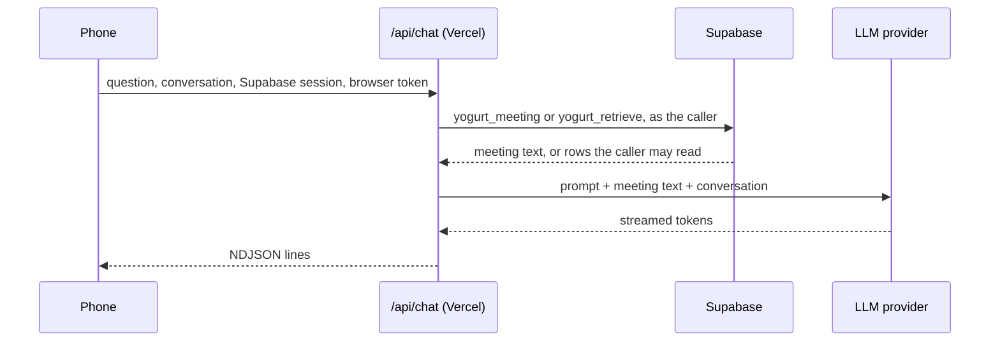

# Chat in the Yogurt Cloud webapp

SYNC-18 and SYNC-19 are built. Written 2026-10-27.
Tickets: `docs/TODO.md` SYNC-18 (chat about one meeting) and SYNC-19 (chat across meetings).

The phone can read and search every meeting but cannot ask about them.
Local yogurt has two chats, and the webapp gets both, built from the same prompts and context.

| Local feature | Local code | Webapp |
| --- | --- | --- |
| Chat about one meeting | `crates/yogurt-server/src/api/chat.rs`, `web/src/components/ChatWindow.tsx` | SYNC-18, on the meeting page |
| Chat across meetings | `crates/yogurt-server/src/api/library_chat.rs`, `web/src/hooks/useLibraryChat.ts` | SYNC-19, on the library |

## What changes in the rules

The webapp has been static files, so no Yogurt Cloud piece has ever called an LLM or seen a meeting outside Supabase.
Chat needs a server, because an LLM API key cannot ship in browser code.

- **A Vercel function.** `cloud/api/chat.ts` runs in the same Vercel project as the webapp, at `/api/chat` on the Cloud address.
  It is the only server code Yogurt Cloud adds.
- **Vercel sees meeting text.** The function reads the meetings a question needs and passes them to the LLM provider.
  It keeps nothing and logs no content, but "Vercel never sees a meeting" stops being true.
- **A new home for one secret.** The LLM key lives in the Vercel project's environment, as a production-only sensitive variable.
  AGENTS.md's hard constraint says API keys live only in `keys.json`, which stays true for the laptop and gains this one exception for the Cloud.
- **Content to the LLM provider from Vercel.** Notes and transcripts already leave the Mac for the LLM provider the user configures.
  With chat, the Cloud sends them to the provider configured for the Cloud, and to nothing else.

### The database URL in the function's environment

Vercel gives a function every project variable, with no build-only scope.
So `POSTGRES_URL_NON_POOLING`, which `build.mjs` uses to apply the schema, and any other variable the Supabase integration set, are in the function's environment too.
The function never reads them.
It reads exactly five names: `SUPABASE_URL`, `SUPABASE_PUBLISHABLE_KEY`, and the three `YOGURT_LLM_*` below.
A Vitest case scans `cloud/api/` and fails on any other `process.env` read, and the function adds no dependencies, only `fetch`.

## Configuration

Three environment variables on the Vercel project:

```
YOGURT_LLM_BASE_URL   https://api.minimax.io/v1
YOGURT_LLM_MODEL      MiniMax-M3
YOGURT_LLM_API_KEY    (sensitive, production only)
```

Any OpenAI-compatible chat completions endpoint works, the same as an HTTP provider in local Settings.
The local CLI providers (Claude Code, Cursor Agent, OpenCode) cannot run on Vercel.
With any of them unset, the function answers "Chat isn't set up on this Cloud." as a final delta.

For Richard's Cloud, setup copies the active local provider, MiniMax-M3, piping the key from `keys.json` into `vercel env add --sensitive` so it is never printed.

## How a question is answered



The function calls Supabase with the caller's own session and browser token through the publishable key, exactly as the browser would.
Postgres enforces the owner and passcode checks as it does for every read, so through this path the function reads only what the caller could.
A request without a valid PIN-unlocked browser token fails at that read, before any LLM call, so the endpoint is never an open proxy to the key.

### Requests

The function takes meeting text from the database and never from the request.
The request carries the conversation, the meeting's device and meeting ids for SYNC-18, and the browser's time zone for SYNC-19.
A request with neither, or with a time zone the runtime does not know, is refused.
It returns 400, before any read, unless:

- the body is at most 64 KB,
- every turn's role is `user` or `assistant`, as local `post_library_chat` checks,
- the last turn is a non-empty user question of at most 4 KB.

SYNC-19 sends the last 6 earlier turns to the model, as local `HISTORY_TURNS` does.
SYNC-18 sends the whole page conversation, as local per-meeting chat sends its whole saved history.
Past 60 KB the webapp drops the oldest exchanges first, so a long chat stays under the 64 KB cap.

The function logs nothing, so no question, answer, meeting text, or token reaches Vercel's logs.
It trims each variable, scrubs the key from a provider's whole error body before shortening it, and scrubs credentials from a base URL in an error.
The LLM call stops after 50 seconds, under the function's 60 second limit, and ends with a stream error the user sees, as the desktop's 60 second request timeout does.
Closing the meeting or the page cancels the request, and the function then cancels the LLM call, so the model stops spending the owner's key.
A failed Supabase read returns 502 with "Chat couldn't reach your Cloud. Try again." instead of throwing.

Both calls use plain `fetch`: PostgREST's `/rest/v1/rpc/...` for Supabase, and `chat/completions` with `stream: true` for the LLM, whose server-sent events the function reads and re-emits.

### Responses

NDJSON, the format of local `POST /api/chat`:

```
{"sources":[{"device_id":"...","meeting_id":"...","title":"...","started_at":1761000000000}]}
{"delta":"The vendor decision was "}
{"delta":"Acme [1]."}
```

The `sources` line comes first and only for SYNC-19.
A failure after streaming starts arrives as a final `{"delta":"[...]"}`, as local does.
Local per-meeting chat streams over the meeting WebSocket instead, which Vercel cannot host, so SYNC-18 uses this NDJSON too.

A rejected browser token comes back from the read as PostgREST's 403 with code `28000`.
The function returns that status and code unchanged, and the webapp's chat client maps it through the same check as `cloud/src/lib/api.ts`, raising `TokenRejected`, which sends the user to Unlock.
The client refreshes the Supabase session before each request, as supabase-js does for every other read.

### Prompts

`cloud/api/_prompts.ts` holds `chat-system.md` from `crates/yogurt-prompts/templates` verbatim in a template literal, and SYNC-19 adds `library-chat-system.md` the same way.
`scripts/check-docs.sh` fails when the copy differs from the template.
It runs in the Docs workflow on every PR, including a prompt-only one that the main CI skips as docs.
The fix lands inside `cloud/`, which redeploys the webapp.
Copying in code avoids depending on how Vercel bundles a file from outside `cloud/`, and Vite's `?raw` never runs on `cloud/api/`.

## SYNC-18: chat about one meeting

**Reading the meeting.** The function calls `yogurt_meeting(token, device_id, meeting_id, null)` from SYNC-12, which returns the current version.

**Context.** The same as local `run_stream`: the `chat-system.md` prompt, then `TRANSCRIPT SO FAR (most recent at bottom):` followed by the transcript as `[mm:ss] me:` and `[mm:ss] them:` lines, then the conversation.
`transcript_lines` moves to TypeScript with its Rust test cases copied.
Local per-meeting chat sends the transcript and not the notes, and the webapp matches it.
Adding the notes is a prompt change for both apps together.

**UI.** The desktop's own Ask this meeting pill and chat window, imported from `web/src/components`.
They sit at the bottom of the meeting's column and stay in view while it scrolls, on a phone and in the desktop's meeting pane.
`ChatMessage.tsx` drew the cross-meeting citation chips with `react-router` and TanStack Query, which the webapp does not have, so the chips moved to `ChatSources.tsx` and the window takes them through `renderExtra`.
`AskPill` and `ChatWindow` take a `position`, defaulting to the desktop's floating one, and hide the ⌘K hint on touch screens.
On a phone the webapp scales the chat's 14px and 13px text to 16px and 15px, the webapp's phone scale.
Chat shows only on the current library, never on a meeting opened from an earlier push in History.
The conversation's state lives in the library screen, above the phone and desktop layouts, so rotating a phone across the breakpoint keeps it.
A transcript link collapses the chat, so the line it scrolls to is not under the window.
In the shared window, Enter that commits an IME composition does not send, and Escape typed into another field, such as search, does not collapse the chat.
One question streams at a time.
The desktop chat is the reference design, so there are no separate mocks.

**Not kept.** The conversation lives in the page, as local cross-meeting chat does.
A reload or leaving the meeting clears it, and nothing is written to Supabase.
The laptop's own saved chat for the meeting, which rides in each pushed version's `chat` array, is not shown.

## SYNC-19: chat across meetings

**Retrieval.** A new RPC, `yogurt_retrieve(token, terms text[], from_ms bigint, to_ms bigint, k int)`, approximates local `MeetingRepo::retrieve`:

- With terms, it ORs them as prefix matches against `yogurt_search_index` and returns the top `k` (6, local `TOP_K`).
  It ranks with `ts_rank` and length normalization, newest first on ties, where local uses FTS5's `bm25`, so the two can order close matches differently.
- The excerpt is at most 64 words from `ts_headline` over the version's transcript text alone, as local `snippet` reads only the transcript column.
  The index's `doc` joins notes and transcript, and the notes are already in the prompt.
- With no terms, or terms that match nothing, it returns the newest `k` in the date range, so a recap such as "What did I decide last week?" still reads that week.
  Local returns nothing then, which leaves its own suggestion unanswered.
- Each term goes in quotes with its backslashes and quotes removed, so the parser splits it as it splits the index and no term is read as `tsquery` syntax.
  Filtering to `[:alnum:]` would drop the combining marks of Hindi or Thai under an ICU collation.
- Ranking uses the index, and each row is read from the meeting's latest version, so an edit the index has not caught up to answers with its new text.
- Each row carries the title, start time, device and meeting ids, and the notes: the enhanced notes when they hold any text, else the user's notes.
- It reads only the live library and hides a meeting whose latest version is a deletion, as `yogurt_search` does.
- It checks the owner and the browser token like every other read.

**Ported from Rust.** `extract_terms`, `date_range`, and `yogurt_notes::ast::strip_markers` move to TypeScript in `cloud/api/`, with the stopword and month lists unchanged and their Rust test cases copied into Vitest.
"Today", "this week", "in December", and each hit's date use the time zone the browser sends.
One change from the Rust: a word keeps its combining marks, where local splits Hindi at the virama.
Both apps read "may" and "march" as months only next to a date cue, such as "in May", "last March", "May 12th", or "May 2025" (LLM-12).
A day whose midnight a DST change skips starts when the clocks jump.

**Context.** The same as local `build_messages`: the `library-chat-system.md` prompt with today's date, then a `MEETINGS:` block numbering each hit `[1]` to `[6]` with its title, date, notes with markers stripped, and excerpt, then the conversation.
Each question numbers its own hits, so the client sends earlier answers back without their `[n]`, and a `[n]` the user typed as the title and date of the meeting it meant, through `web/src/lib/citations.ts`, which the desktop's library chat uses too (LLM-11).
Replacing an answer's `[n]` with its title instead made MiniMax-M3 drop citations in 3 of 8 follow-ups, and keeping it made it cite the wrong meeting in 5 of 5 follow-ups whose list had shifted.

**UI.** The desktop's Ask across meetings pill and chat window, with its copy, docked at the bottom of the library list on a phone and of the empty meeting pane on a desktop.
Each cited meeting shows as the desktop's chip, which opens `#/m/<device>/<meeting>`, keyed by the `device_id` and `meeting_id` in `sources`.
`ChatSources` takes a `link` that renders each chip, so the desktop wraps it in a router `Link` and the webapp in a plain link.
The conversation lives in the library screen, so opening a cited meeting and coming back keeps it, folded into the pill.
On a desktop the logo closes the open meeting, which is the way back to the library chat.
One question streams at a time, and the shared window keeps a follow-up typed meanwhile in its field.
One hook, `cloud/src/lib/useChat.ts`, serves both chats, and takes a meeting or the browser's time zone as its scope.
The library chat shows only on the current library, never as of an earlier push.

## Testing

- **Function unit tests.** Vitest covers the ports, the SSE-to-NDJSON relay, the 400 rules, the 403 pass-through, the `process.env` scan, key scrubbing, error frames, content parts, cancellation, and that a failed Supabase read makes no LLM call.
- **End to end.** `just test-cloud-web` runs Playwright against `vite preview`.
  A Vite plugin mounts the handler at `/api/chat` through `configurePreviewServer`, and a fake OpenAI-compatible server streams fixed tokens and records each request.
  The specs check that the recorded prompt holds the meeting's transcript, that a locked browser reaches Unlock while the fake server sees nothing, and, for SYNC-19, that each chip opens its meeting.
- **Schema.** `just test-cloud-schema` covers `yogurt_retrieve`: ORed prefix terms, the date range, transcript-only excerpts, the deletion rule, the token check, and the upgrade from main and back.
- **Vercel bundling.** The plugin runs the handler through Vite, not through Vercel's function build, so each PR's Vercel preview is checked by posting a question to its `/api/chat`.
  Previews have no `YOGURT_LLM_*` variables, so the expected answer is "Chat isn't set up on this Cloud.", which proves the function bundles and runs.
- **Production.** After landing, ask a question on the phone about a recent meeting, and for SYNC-19 one that names a month.

## Docs

These lines say the webapp has no server code, and each changes in SYNC-18:

- `docs/CLOUD-SYNC.md` line 18, "so Vercel never sees a meeting".
- `docs/.planning/sync-cloud-mirror-design.md` line 10, "a static webapp", and line 72, "The webapp has no server functions".

`docs/CLOUD-SYNC.md` also gains a Chat section, the three variables in setup, and the LLM provider in "who can read what".
AGENTS.md and `docs/ARCHITECTURE.md` record the Vercel key exception.
`docs/FEATURES.md` maps the local app only, so it does not change.

## Open questions

Each has a default the tickets build unless Richard picks otherwise.

1. **Keep phone chats?** Default: no, the conversation lives in the page.
   Keeping them needs a new owner-only table and a list of past chats.
2. **Same key as the Mac, or a separate one?** Default: copy the Mac's active provider and key.
   A separate key from the same provider can be revoked without breaking the Mac.
3. **Show the laptop's saved chat on the meeting page?** Default: no.
