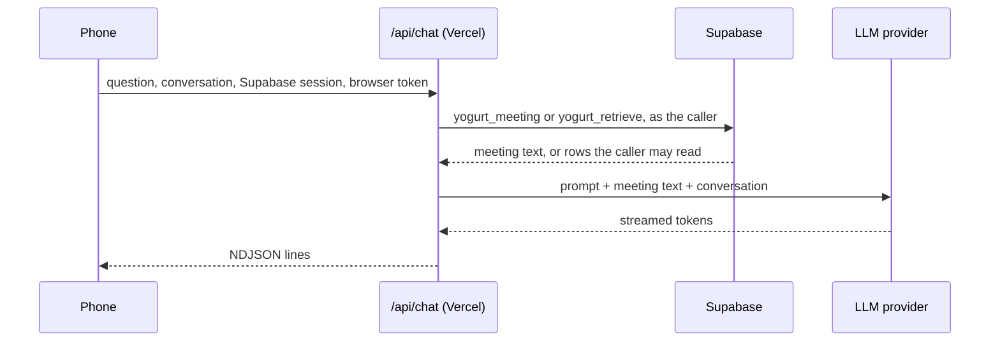

# Chat in the Yogurt Cloud webapp

Design, not started. Written 2026-10-27.
Tickets: `docs/TODO.md` SYNC-18 (chat about one meeting) and SYNC-19 (chat across meetings).

The phone can read and search every meeting but cannot ask about them.
Local yogurt has two chats, and the webapp gets both, answering the same way.

| Local feature | Local code | Webapp |
| --- | --- | --- |
| Chat about one meeting | `crates/yogurt-server/src/api/chat.rs`, `web/src/components/ChatWindow.tsx` | SYNC-18, on the meeting page |
| Chat across meetings | `crates/yogurt-server/src/api/library_chat.rs`, `web/src/hooks/useLibraryChat.ts` | SYNC-19, on the library |

## What changes in the rules

The webapp has been read-only static files, so no Yogurt Cloud piece has ever called an LLM.
Chat needs a server, because an LLM API key cannot ship in browser code.

- **A Vercel function.** `cloud/api/chat.ts` runs in the same Vercel project as the webapp, at `/api/chat` on the Cloud address.
  It is the only server code Yogurt Cloud adds, and it holds no database credentials.
- **A new home for one secret.** The LLM key lives in the Vercel project's environment, as a production-only sensitive variable, beside the database URL that `build.mjs` already reads there.
  AGENTS.md's hard constraint says API keys live only in `keys.json`, which stays true for the laptop and gains this one exception for the Cloud.
- **Content to the LLM provider from Vercel.** Notes and transcripts already leave the Mac for the LLM provider the user configures.
  With chat, the Cloud sends them to the provider the user configures for the Cloud, and to nothing else.

## Configuration

Three environment variables on the Vercel project, read at request time:

```
YOGURT_LLM_BASE_URL   https://api.minimax.io/v1
YOGURT_LLM_MODEL      MiniMax-M3
YOGURT_LLM_API_KEY    (sensitive, production only)
```

Any OpenAI-compatible chat completions endpoint works, the same as an HTTP provider in local Settings.
The local CLI providers (Claude Code, Cursor Agent, OpenCode) cannot run on Vercel.
`build.mjs` writes `chat: true` into the webapp's config when all three are set, and the webapp shows chat only then.
A variable change takes effect on the next deploy, as Vercel applies environment changes.

For Richard's Cloud, setup copies the active local provider, MiniMax-M3, piping the key from `keys.json` into `vercel env add --sensitive` so it is never printed.

## How a question is answered



The function calls Supabase with the caller's own session and browser token through the publishable key, exactly as the browser would.
Postgres enforces the owner and passcode checks as it does for every read, so the function can only read what the caller could.
A request without a valid PIN-unlocked browser token fails at that read, before any LLM call, so the endpoint is never an open proxy to the key.

The function takes meeting text from the database and never from the request.
The request carries only the question, the earlier turns, the meeting's ids for SYNC-18, and the browser's time zone for SYNC-19's date phrases.
It caps the question at 4 KB and sends at most the last 6 earlier turns, as local does (`HISTORY_TURNS`).

The function logs status codes and error kinds only, never a question, an answer, meeting text, or a token.

Both calls use plain `fetch`: PostgREST's `/rest/v1/rpc/...` for Supabase, and `chat/completions` with `stream: true` for the LLM, whose server-sent events the function reads and re-emits.
No SDK is added.

### Wire format

The same NDJSON as local `POST /api/chat`, so the webapp can reuse the local client code:

```
{"sources":[{"device_id":"...","meeting_id":"...","title":"...","started_at":1761000000000}]}
{"delta":"The vendor decision was "}
{"delta":"Acme [1]."}
```

The `sources` line comes first and only for SYNC-19.
A failure arrives as a final `{"delta":"[...]"}`, as local does.
An expired session or a rejected browser token returns 401 before streaming, and the webapp sends the user to Unlock as any other rejected read does.

### Prompts

The function imports `crates/yogurt-prompts/templates/chat-system.md` and `library-chat-system.md` as raw text at build time, so both apps answer from the same prompt files.
Vercel clones the whole repo, which SYNC-5 already relies on for `web/src`.
`cloud/vercel.json`'s `ignoreCommand` adds `../crates/yogurt-prompts/templates`, so a prompt change redeploys the webapp.

## SYNC-18: chat about one meeting

**Context.** The same as local `run_stream`: the `chat-system.md` prompt, then the transcript as `Me:` and `Them:` lines, then the conversation.
Local per-meeting chat sends the transcript and not the notes, and the webapp matches it, so a meeting gets the same answer on both.
Adding the notes is a prompt change for both apps together.

**Reading the meeting.** The function calls `yogurt_meeting(token, device_id, meeting_id, null)` from SYNC-12, which returns the current version.

**UI.** An Ask button in the meeting page header opens the chat over the meeting, a sheet from the bottom on a phone and a side panel on desktop.
The message list and composer are the shared `web/src/components/ChatWindow.tsx` and `ChatMessage.tsx`, imported the way SYNC-5 imports the transcript line.
Chat shows only on the current library, never on a meeting opened from an earlier push in History.
The implementation PR adds light and dark mocks to the review surface before building.

**Not kept.** The conversation lives in the page, as local cross-meeting chat does.
A reload or leaving the meeting clears it, and nothing is written to Supabase.
The laptop's own saved chat for the meeting, which rides in each pushed version's `chat` array, is not shown.

## SYNC-19: chat across meetings

**Retrieval.** A new RPC, `yogurt_retrieve(token, terms text[], from_ms bigint, to_ms bigint, k int)`, mirrors local `MeetingRepo::retrieve`:

- With terms, it ORs them as prefix matches against `yogurt_search_index`, ranks by `ts_rank`, newest first on ties, and returns the top `k` (6, local `TOP_K`) with a transcript excerpt of about 64 words from `ts_headline`.
- With no terms, it returns the newest `k` in the date range.
- Each row carries the title, start time, device and meeting ids, and the notes: the enhanced notes when present, else the user's notes.
- It reads only the live library and hides a meeting whose latest version is a deletion, as `yogurt_search` does.
- It checks the owner and the browser token like every other read.

**Terms and dates.** `extract_terms` and `date_range` move from Rust to TypeScript in `cloud/api/`, with the stopword and month lists unchanged.
"Today", "this week", and "in December" resolve in the time zone the browser sends.
The Vitest file copies the Rust test cases, so a change to one shows up as a failing case in the other.

**Context.** The same as local `build_messages`: the `library-chat-system.md` prompt with today's date, then a `MEETINGS:` block numbering each hit `[1]` to `[6]` with its title, date, notes, and excerpt, then the conversation.

**UI.** An Ask field beside the search field on the library opens the conversation, with each cited meeting shown as a chip that opens it, as local does.
The client hook follows `web/src/hooks/useLibraryChat.ts`, reading the same NDJSON.

## Testing

- **Function unit tests.** Vitest covers the term and date port, the SSE-to-NDJSON relay, the request caps, and that a failed Supabase read makes no LLM call.
- **End to end.** `just test-cloud-web` gains chat specs against the local Supabase and a fake OpenAI-compatible server that streams fixed tokens and records each request.
  A Vite dev-server plugin mounts the handler at `/api/chat`, so the specs run without `vercel dev`.
  They check that the recorded prompt holds the meeting's transcript, that a locked browser gets 401 and the fake server sees nothing, and, for SYNC-19, that the cited chips open the right meetings.
- **Schema.** `just test-cloud-schema` covers `yogurt_retrieve`: ORed prefix terms, the date range, the deletion rule, the token check, and the upgrade from main and back.
- **Production.** After landing, ask a question on the phone about a recent meeting, and for SYNC-19 one that names a month.

## Docs

`docs/CLOUD-SYNC.md` gains a Chat section, the three variables in setup, and the LLM provider in "who can read what".
AGENTS.md and `docs/ARCHITECTURE.md` record the Vercel key exception.
The mirror design's out-of-scope line points here.
`docs/FEATURES.md` gains the two webapp chat rows.

## Open questions

Each has a default the tickets build unless Richard picks otherwise.

1. **Keep phone chats?** Default: no, the conversation lives in the page.
   Keeping them needs a new owner-only table and a list of past chats.
2. **Same key as the Mac, or a separate one?** Default: copy the Mac's active provider and key.
   A separate key from the same provider can be revoked without breaking the Mac.
3. **Show the laptop's saved chat on the meeting page?** Default: no.
