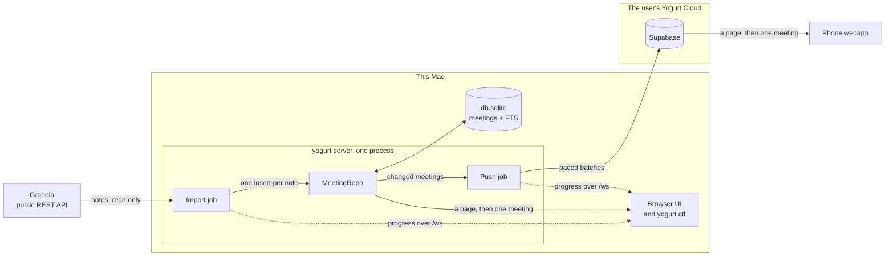
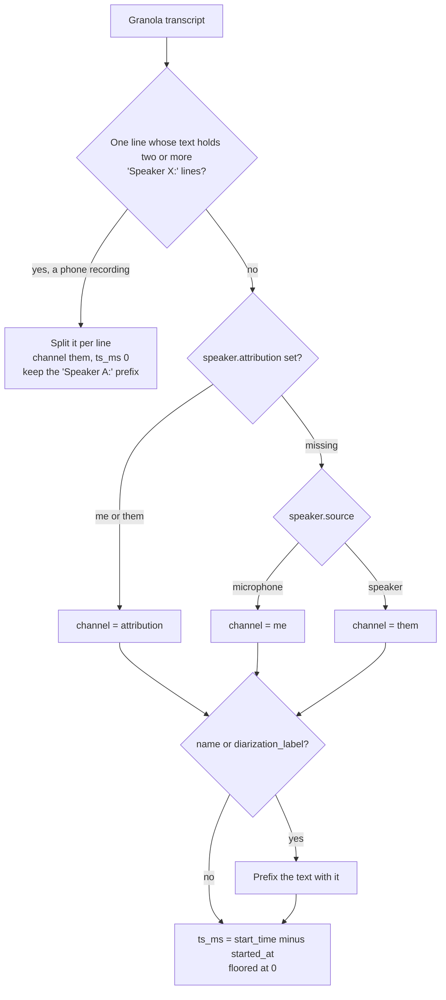
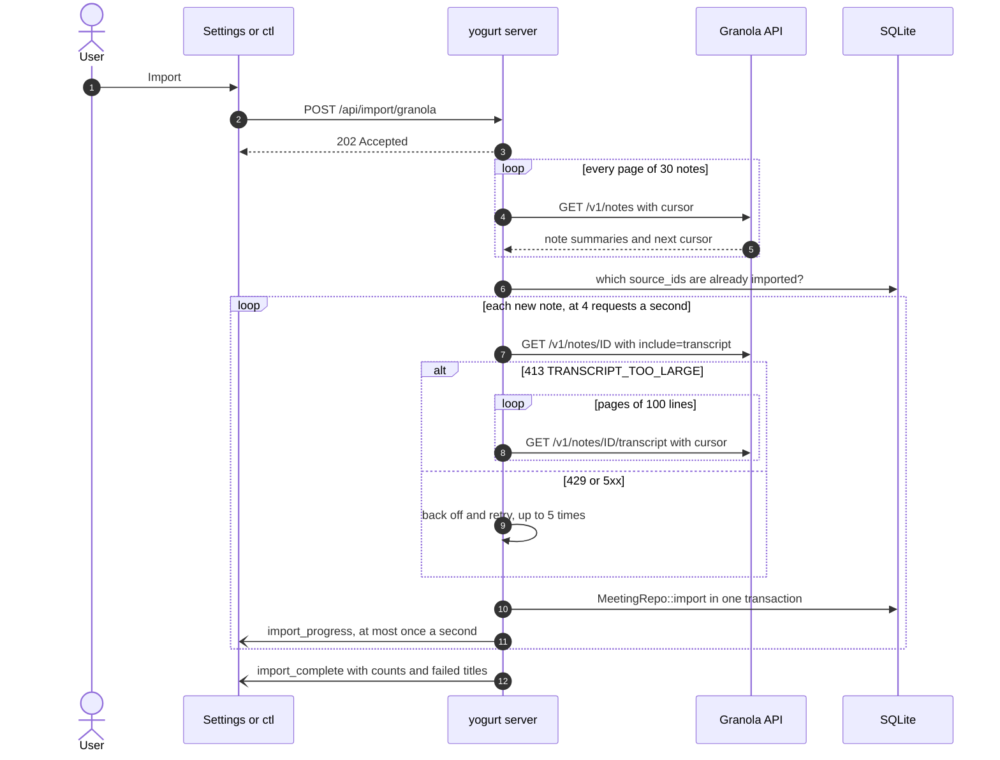
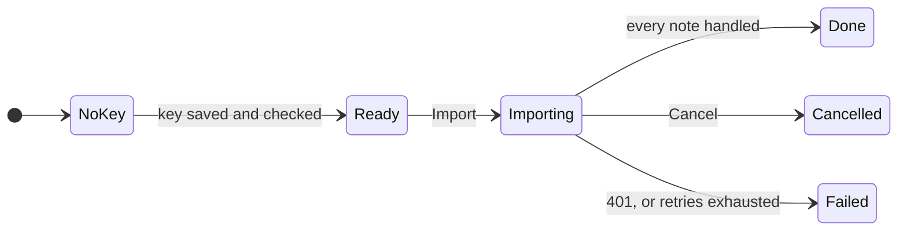
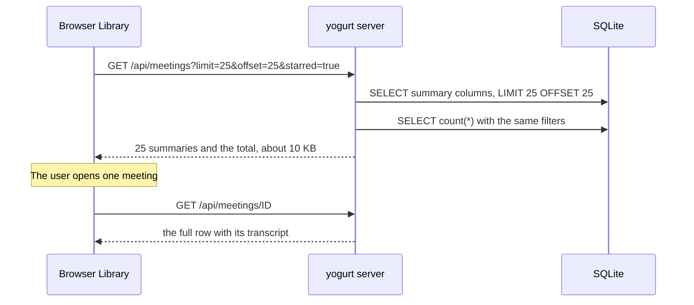
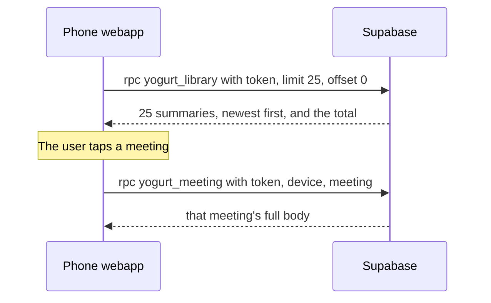
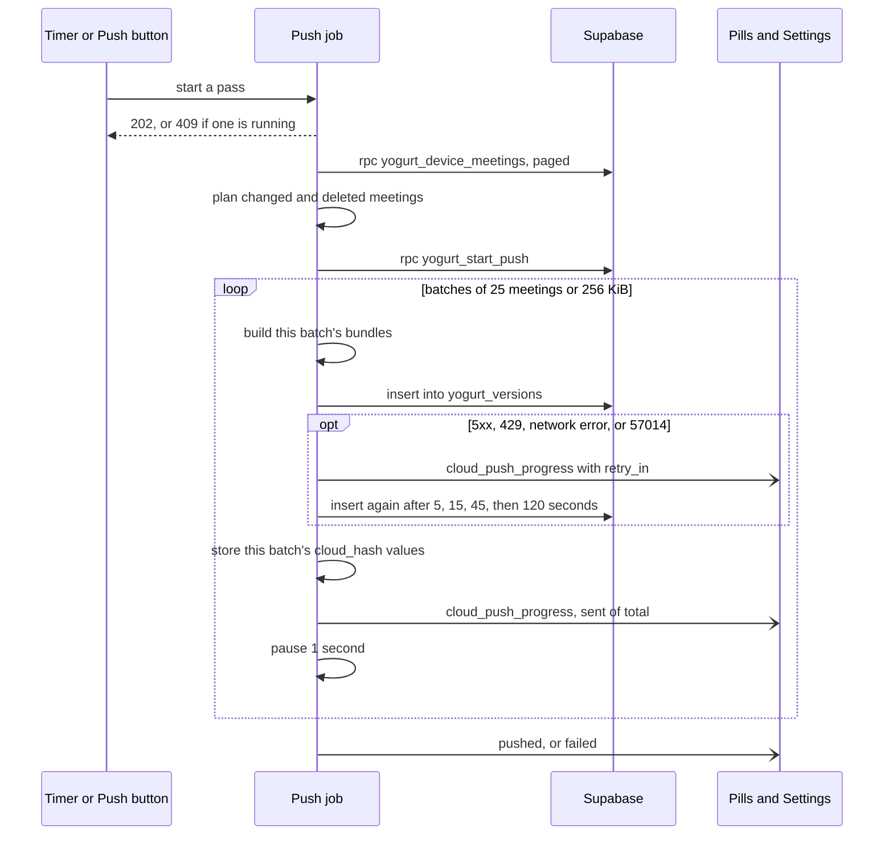
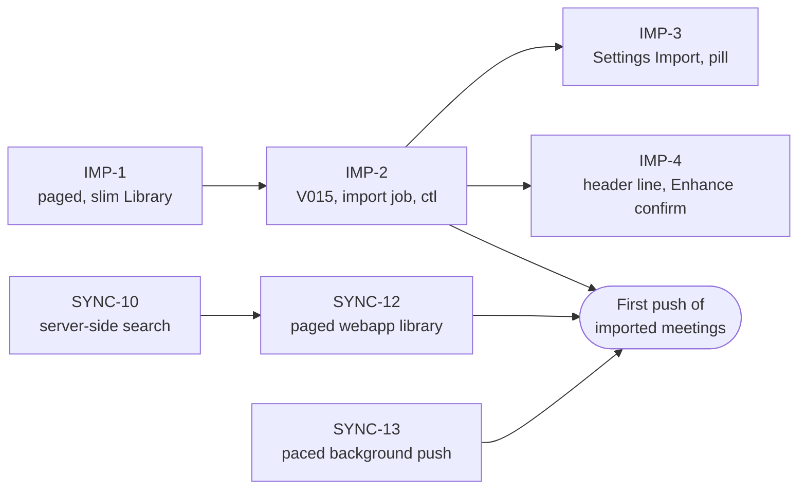

# IMP: import Granola meetings into yogurt

Design, not started. Decisions settled 2026-10-25.
Tickets: `docs/TODO.md` IMP-1 through IMP-4, plus SYNC-12 and SYNC-13 for Yogurt Cloud.

jarvisrchen has 1,429 meetings in Granola going back to June 2025 and wants all of them searchable and chattable in yogurt.
Granola's public REST API returns 1,365 of them, and this design imports exactly those.
The import is a one-shot job the user starts from Settings or `yogurt ctl`, and running it again only picks up meetings that are new since the last run.

## Rules

- The import is opt-in. Nothing talks to Granola until the user saves a Granola API key and starts an import.
- Data flows one way, from Granola into yogurt. Yogurt sends Granola only the API key and read requests, never notes, transcripts, or anything recorded in yogurt.
- An imported meeting is a normal yogurt meeting. It is searchable, chattable, labelable, editable, and pushed to Yogurt Cloud like any other.
- A meeting is imported once. A later run skips it even if Granola has changed it since, because the user may have edited it in yogurt.
- Meetings someone else captured and shared with the user are imported too, with a note of who captured them.
- Meetings with no AI summary or no transcript are skipped. The Granola API already leaves them out.
- Out of scope: calendar events, photo attachments, Granola chat history, two-way sync, propagating deletions, and imports from other apps.

## Architecture

Everything new runs inside the one yogurt server process.
The import job only reads from Granola, and the push job only writes to the user's own Supabase project.



The Granola key and the Cloud session both live in `keys.json`, and the UI and `ctl` start and cancel both jobs through the routes listed under API.

## Source: the Granola public API

The only supported, structured way to read Granola data is the public REST API at `https://public-api.granola.ai/v1`.
It needs a Business or Enterprise plan, and the user creates a personal key in the Granola desktop app under Settings, Connectors, API keys.
Keys start with `grn_` and go in an `Authorization: Bearer` header.
A personal key sees notes the user owns, notes shared directly with them, and notes in private folders shared with them.

The endpoints the importer uses (OpenAPI spec at https://docs.granola.ai/api-reference/openapi.json, checked 2026-10-25):

| Endpoint | Use |
| --- | --- |
| `GET /v1/notes?page_size=30&cursor=` | List every note. Returns `{notes, hasMore, cursor}`, with `page_size` at most 30. Also takes `created_after`, `created_before`, `updated_after`, `folder_id`, and `space_id`. |
| `GET /v1/notes/{not_id}?include=transcript` | One full note with its transcript. |
| `GET /v1/notes/{not_id}/transcript?page_size=100&cursor=` | Paged transcript, for when the call above returns 413 `TRANSCRIPT_TOO_LARGE`. |

Note IDs look like `not_wwsowkcig8vywq`.
The API rejects the UUIDs that Granola's web URLs and MCP use, with a 400.
Rate limits are 5 requests a second sustained with a burst of 25, and going over returns 429.
The docs do not describe the error body or a `Retry-After` header.

Other routes were rejected:

- **The Granola MCP** works for this account, but it returns text formatted for an LLM, allows about 100 requests a minute, and needs a browser OAuth flow. It suits reading a few meetings from Claude, not a bulk import.
- **The CSV export** (Settings, Profile, Generate CSV) covers only notes the user owns, is emailed a few hours later, and probably carries no per-line timestamps or speaker channels.
- **The local cache and the internal API** are encrypted since May 2026 and undocumented respectively, and scraping them conflicts with Granola's terms of service.

## What Granola has, measured

A full listing returned 1,365 notes from 2025-06-25 to 2026-10-22.

| Captured by | Notes |
| --- | --- |
| rchenconsulting@gmail.com (the user) | 1,292 |
| The user's per-client accounts (rchencrm, rchenthd, rchenmsft, rchenorcl, rchenoreilly) | 48 |
| apandeyconsultancy@gmail.com | 25 |

A sample of 51 notes, every 27th in the listing, all fetched with `include=transcript`:

| Measure | Result |
| --- | --- |
| Owned by the user | 48 of 51 |
| Have private notes (typed by the user) | 3 of 51 |
| Have a folder | 41 of 51, none nested |
| Have a title of `null` | 2 of 51 |
| Attendees beyond the note owner | 0 of 51 |
| Calendar event | 0 of 51 |
| Photo attachments | 0 of 51 |
| Team spaces | 0 of 51 |
| Transcript lines with a speaker `name` or `diarization_label` | 0 of 51 |
| Transcript lines missing `attribution` | 0 of 51 |
| Phone recordings returned as one text block | 1 of 51 |
| Transcript length | average 23,817 characters, maximum 140,191 |
| Summary length | average 2,215 characters |
| First transcript line after note creation | 0 to 851 seconds |
| Audio length | 2 to 303 minutes |

No sampled note needed the paged transcript endpoint, including the 140,191-character one.
The whole import is about 35 MB of text.

## Mapping a Granola note to a yogurt meeting

One Granola note becomes one row in `meetings`:

| yogurt column | From Granola |
| --- | --- |
| `id` | A new UUID v7 stamped with `started_at`, so IDs sort in meeting order like native ones. |
| `title` | `title`, or the server's dated default for an empty title when it is `null`. |
| `started_at` | The first transcript line's `start_time`, which is when audio began. For a phone recording's single block, `created_at`. |
| `ended_at` | The latest `end_time` across the transcript. Never left null. |
| `notes_md` | `private_notes_markdown`, or `""` when it is `null`, which is always the case for notes the user does not own. |
| `enriched_md` | `summary_markdown`, falling back to `summary_text`, run through `sanitize_enriched_md`. |
| `transcript_json` | One `{ts_ms, channel, text}` entry per transcript line, as described below. |
| `stt_engine`, `llm_model`, `template` | `NULL`, so the model pills stay hidden. |
| `source`, `source_id`, `source_json` | New. See Schema. |
| Labels | One label per entry in `folder_membership`, found or created by name. |

Transcript lines:

- `ts_ms` is `start_time` minus `started_at`, floored at 0.
- `channel` is `speaker.attribution` (`me` or `them`). If it is missing, `microphone` maps to `me` and `speaker` to `them`.
- If a line has a `diarization_label` or a `name`, the text gets that prefix, as in `Speaker A: ...`, because yogurt's transcript has no speaker field.

Phone recordings come back as a single line labeled `microphone` and `me`, whose text holds every speaker as `Speaker A: ...` lines.
Taken literally, that would file the whole conversation as the user.
When a note's transcript is one line and its text has two or more lines starting with `Speaker <letters>:`, the importer splits it into one segment per line.
Each segment keeps its `Speaker A:` prefix, has channel `them`, and has `ts_ms` 0, since Granola gives no per-line times.

How one Granola transcript becomes `transcript_json`:



The summary is markdown with `###` headings, bold, and nested lists, all of which `sanitize_enriched_md` keeps.
It has no `data-transcript-link` spans, so imported Enhanced notes show without transcript citations.
The sanitizer escapes a bare `>`, so a markdown blockquote in a summary would render as text. No sampled summary had one.

## Schema

One migration, `crates/yogurt-db/migrations/V015__meetings_source.sql`:

```sql
ALTER TABLE meetings ADD COLUMN source TEXT;       -- NULL for meetings recorded in yogurt, 'granola' for imports
ALTER TABLE meetings ADD COLUMN source_id TEXT;    -- Granola's not_ id
ALTER TABLE meetings ADD COLUMN source_json TEXT;  -- {"owner":{"name","email"},"web_url","updated_at","imported_at"}
CREATE UNIQUE INDEX idx_meetings_source ON meetings(source, source_id) WHERE source IS NOT NULL;
```

The unique index is what makes a re-run safe, and the insert is `INSERT ... ON CONFLICT DO NOTHING`.
`source_json` holds the fields that are shown but never queried.
`owner` records who captured the meeting, `web_url` backs an "Open in Granola" link, and `updated_at` leaves room for a future refresh.
`Meeting` gains `source` and a parsed `source_json`, so the API, the markdown export's front matter, and the Yogurt Cloud bundle all carry them with no further work.

The migration rebuilds nothing, because `meetings_fts` indexes title, notes, enriched notes, and transcript, and none of those change.
It must land on `main` before any branch build touches `~/.yogurt`, per the shared-database migration hazard.

## Data Granola has that yogurt does not

| Granola data | In yogurt today | Present in this account | Decision |
| --- | --- | --- | --- |
| Who captured the note (`owner`) | No. Every meeting is implicitly the user's. | 73 of 1,365 are someone else's | **Add**, as `source_json.owner`, shown in the meeting header. |
| Link back to Granola (`web_url`) | No | Every note | **Add**, as `source_json.web_url`, shown as "Open in Granola". |
| Granola ID | No | Every note | **Add**, as `source_id`. Needed to skip duplicates. |
| Attendees (name, email) | No | Only the owner, in 51 of 51 sampled. The account has no calendar connected, so the list never holds anyone else. | **Defer.** An `attendees` column would be empty for every import. Add it when yogurt or Granola can fill it, with a V013-style FTS rebuild so names become searchable. |
| Calendar event | No | 0 of 51 | **Skip**, by the user's decision. |
| Photo attachments | No | 0 of 51 | **Skip.** The URLs can change and would need downloading. Revisit if yogurt gains attachments. |
| Speaker names and diarization labels | `me` and `them` only | 0 of 51, apart from labels inside phone blocks | **Keep as text prefixes.** A per-segment `speaker` field waits for yogurt's own diarization. |
| Per-line `end_time` | Start offset only | Every line | **Skip.** `ended_at` comes from the last one. |
| Nested folders | Flat labels | 0 of 51 nested | **Flatten.** `folder_membership` already lists ancestors, so each becomes a label. |
| Team spaces | No | 0 of 51 | **Skip.** |
| Plain-text copies (`summary_text`, `private_notes_text`) | Not needed | Every note | **Skip**, except `summary_text` as a fallback. |
| Granola chat history and shared-screen screenshots | No | Not in the REST API | **Out of scope.** |

## The import job

The server runs the import as one background task, shaped like the model download job (UI-22).
It owns every call to Granola, so the server is the only place in yogurt that talks to Granola, whether the import starts from Settings or `ctl`.

1. **Preview.** List every note, which is 46 requests and about 10 seconds for this account. Count the total, how many are already imported, and how many someone else captured. Fetch nothing else.
2. **Import.** For each note not already imported:
   - Fetch it with `include=transcript`. On 413, page `/transcript` at 100 lines a page instead.
   - Map it as described above.
   - Insert it with `MeetingRepo::import`, a new repo method that writes the row, its transcript, notes, enriched notes, and labels in one transaction.
   - Write its markdown export once.
3. **Finish.** Report the counts and the titles of any notes that failed.



Requests go through a token bucket at 4 a second, under Granola's 5.
A 429 or a 5xx retries with exponential backoff up to 5 times, honoring `Retry-After` if Granola ever sends one.
A 401 stops the job with "Granola rejected the API key".
A 404 or a mapping error fails only that note, and the job moves on.
For this account the job is about 1,411 requests, roughly 6 minutes.

`MeetingRepo::import` skips the path that `POST /api/meetings` takes, because that path does work an import must not repeat 1,365 times:

- It registers each meeting in the in-memory recording registry, which has no eviction.
- It writes the row, then patches it, which runs the FTS trigger twice over a transcript that averages 24 KB.
- It writes the markdown export on every patch, with an `fsync` each time.

Only one import runs at a time, and a second start gets 409.
Cancel sets a flag the job checks between notes.
Meetings already inserted stay, and the next run picks up where this one stopped.

The job's states, as Settings and the pill show them:



Preview runs from Ready and returns to it.
Done, Cancelled, and Failed all return to Ready, and the next run skips every note already imported, so a cancelled or failed run resumes where it stopped.

### API

| Route | Purpose |
| --- | --- |
| `PUT /api/import/granola/key` | Save the key to `keys.json` as account `import-granola`, after one `GET /v1/notes?page_size=1` to check it. |
| `DELETE /api/import/granola/key` | Forget the key. |
| `GET /api/import/granola` | Current state: key masked or absent, the running job's progress, and the last run's result. The UI reconciles from this after a WebSocket reconnect. |
| `POST /api/import/granola/preview` | Run the preview and return its counts. |
| `POST /api/import/granola` | Start the import. Returns 202, or 409 if one is running. |
| `DELETE /api/import/granola` | Cancel. |

WebSocket frames on the app-wide `/ws` stream:

- `import_progress {done, total, imported, skipped, failed}`, at most once a second.
- `import_complete`, `import_error`, and `import_cancelled`.

The broadcast channel holds 64 frames and drops frames for a slow client.
That is why the final state is also readable from `GET /api/import/granola`.

### Key

The key lives only in `~/.yogurt/keys.json`, like every other key.
It never goes in SQLite, a response, or a log, and responses show only the masked form.
For development, a `seed_granola_key_from_env` startup step reads `YOGURT_GRANOLA_API_KEY`, the same way `seed_stt_key_from_env` handles Deepgram.

### CLI

```
yogurt ctl import granola key set          # reads the key from stdin
yogurt ctl import granola --dry-run        # the preview
yogurt ctl import granola --wait           # start and follow progress until done
yogurt ctl import granola cancel
```

`ctl` only calls the routes above, the same way `ctl models download --wait` does.
It never talks to Granola itself.

## Prerequisite: a paginated, slim Library (IMP-1)

`GET /api/meetings` has no pagination and returns every column of every meeting, transcripts included.
Today that is 47 meetings and 541 KB.
After the import it would be about 1,400 meetings and 35 MB, fetched again whenever the Library remounts more than 5 seconds after its last fetch.
`/api/meetings/search` returns the same full rows, capped at 200.
The Library card uses only the title, times, labels, starred, and whether the meeting has Enhanced notes, and opening a meeting already fetches its full row from `GET /api/meetings/{id}`.

IMP-1 fixes both halves: the list returns a page instead of everything, and each row carries only what a card shows.

### API

```
GET /api/meetings?limit=25&offset=0&label_id=<id>&starred=true
GET /api/meetings/search?q=<text>&limit=25&offset=0&label_id=<id>&starred=true
```

Both return `{"meetings": [MeetingSummary], "total": <n>}`, where `total` counts every match before paging.
`limit` is 1 to 100 and defaults to 25. `offset` defaults to 0.
`label_id` and `starred` are optional, and they move the Library's label and starred filters from the browser to SQL.
They have to move, because filtering one page in the browser would show 3 starred meetings out of a page of 25 instead of the first 25 starred meetings.

`MeetingSummary` is `id`, `title`, `started_at`, `ended_at`, `starred`, `labels`, `has_enriched`, and the `stt_engine` and `llm_model` the card shows as pills, plus `source` and the capturer once IMP-2 adds them.
That is a few hundred bytes a row, so a page of 25 is about 10 KB, and a page of 100 is about 40 KB.
Search keeps its current FTS ranking, and its `total` comes from a `COUNT(*)` over the same match.
`GET /api/meetings/{id}` is unchanged and remains the only route that returns a transcript.

Ordering stays `started_at DESC, id DESC`, which keeps pages stable when two meetings share a start time.
At 1,400 rows the sort and the count take well under a millisecond in SQLite, so no new index is needed.



### Library

- A pager under the list shows "26–50 of 1,412", Previous and Next buttons, and a page-size select of 10, 25, 50, or 100. The default is 25.
- The page and size live in the URL as `?page=2&size=25`, so Back from a meeting returns to the same page. The chosen size is also remembered in `localStorage` for the next visit.
- Changing the search text, the label, or the starred filter returns to page 1.
- Day groups render within the page, so a day split across two pages shows its heading on both.
- The greeting's "1,412 meetings · all on this Mac" reads `total` from the unfiltered list instead of counting the rows it has.
- Selection covers the current page. Select all selects the page, shift-click ranges stay within it, and changing page clears the selection. Bulk delete and bulk label act only on what is visible, which is the safer reading.
- TanStack Query keys become `["meetings", {page, size, labelId, starred, q}]`. Existing invalidations of `["meetings"]` still refetch the current page, because invalidation matches by prefix. `placeholderData: keepPreviousData` keeps the old page on screen while the next one loads.
- A live recording is always the newest meeting, so it stays on page 1 and the active-recording poll is unchanged.

### CLI and docs

- `yogurt ctl meeting last` asks for `?limit=1` instead of downloading every meeting to read the first ID.
- `yogurt ctl meeting list --limit N` passes the limit through, and without `--limit` it pages through all meetings at 100 a request.
- `--json` output for `meeting list` becomes summary rows. `docs/AI-INTEGRATION.md` and the `yogurt-control` skill get the new query parameters and response shape.

The Yogurt Cloud webapp's library, shipped in SYNC-5, loads full rows the same way. The Yogurt Cloud section below covers it, because on a phone the full-row version costs real mobile data.

## UI

Settings gains an **Import** section, after Cloud.

- **No key.** A short explanation, a link to Granola's API-key help page, and a key field shaped like the Deepgram one.
- **Key saved.** The masked key, a Remove button, and a Preview step that shows "1,365 meetings in Granola · 0 already imported · 73 captured by someone else" with an Import button.
- **Importing.** A progress bar with done and total, imported, skipped, and failed counts, and Cancel.
- **Done.** The counts, any failed titles, and a link to the Library.

An import takes about 6 minutes, so its progress also shows on every page, in the top-center row that `router.tsx`'s `Shell` already uses for the recording pill, the meeting-detected banner, and the model `DownloadPill`.
An `ImportPill` beside them reads "Importing from Granola · 340 of 1,365" with the download pill's progress ring, and clicking it opens Settings, Import.
When the job finishes it reads "Imported 1,365" and clicking it opens the Library. A failure reads "Import failed" in the error tone, and clicking it shows the error in Settings.
The pill stays until it is clicked, like the download pill, so a result is not missed while the user is elsewhere.
`ProgressRing` moves out of `DownloadPill.tsx` into a shared component so both pills use it.

The post-meeting header of an imported meeting gains one quiet line: "Imported from Granola", then "· Captured by Abhigyan Pandey" when the owner is not the user, then "Open in Granola".
Library cards are unchanged, and folders arrive as labels, so the existing label filter covers browsing by client.

Enhance stays available on imported meetings.
Most imports have no typed notes, so enhancing one rebuilds the Enhanced tab from the transcript alone and replaces Granola's summary.
The Enhance button on an imported meeting confirms first: "This replaces the notes imported from Granola."

## Side effects at this scale

- **Search and Library chat** index imported meetings through the existing FTS triggers, with nothing extra to do.
- **Markdown export** writes about 1,365 files into `~/.yogurt/notes`, named by each meeting's real date.
- **Yogurt Cloud** has no per-create push. If auto-push is on, the next tick pushes every imported meeting. See the next section.
- **Database size** grows by the 35 MB of text plus its FTS index.

## Yogurt Cloud after an import

The push side handles an import.
`yogurt_cloud::push::run` sends changed meetings in batches of 100 rows or 1 MiB, records each batch's hashes as it commits, and refreshes the session before each batch.
About 46 MB of bundles becomes roughly 45 requests, and a pass that fails partway resumes after the last committed batch.
`strip_nul` already removes the U+0000 that Postgres `jsonb` rejects.
The cloud stores a full `jsonb` copy of a meeting per push that changed it, so the import adds about 46 MB before Postgres compression, against the free plan's 500 MB.

Two costs grow with the meeting count:

- **Each push pass rebuilds and hashes every meeting.** `local_meetings` in `api/cloud.rs` reads each meeting and its chat one at a time and hashes its whole bundle on every tick, even when nothing changed. At 1,412 meetings that is about 46 MB of JSON per tick, which should still take a second or two. It is not measured. Comparing `updated_at` against the last push before building a bundle would remove it, and it can wait until a tick is measured as slow.
- **New fields change every hash.** IMP-2 adds `source` and `source_json` to `Meeting`. If they serialize as `null`, every existing meeting's bundle changes and the next pass re-pushes all of them once. They get `#[serde(skip_serializing_if = "Option::is_none")]`, so a meeting recorded in yogurt keeps its hash.

The read side does not handle an import, and SYNC-12 fixes it before the first push of imported meetings:

- **The webapp downloads every meeting in full.** `cloud/src/screens/Library.tsx` calls `yogurt_library`, which returns the latest body of every meeting, transcripts included, and opens a meeting from that same data. After the import that is about 46 MB per Library visit on a phone. Supabase's free plan includes 5 GB of egress a month according to third-party pricing guides, which is about 100 visits.
- **The webapp would silently show only 1,000 meetings.** Supabase caps a response at 1,000 rows by default (`max_rows = 1000` in `cloud/supabase/config.toml`). The laptop client already pages around that cap in `rpc_all`, but the webapp's `api.library` makes one unpaged call. `yogurt_library` orders by `meeting_id`, and UUID v7 IDs sort by time, so the newest meetings would be the ones missing. This is inferred from the code and the config. It has not been reproduced on a live project.

SYNC-12 gives the webapp the IMP-1 treatment:

- `yogurt_library` returns summary fields only (title, times, labels, starred, device, push), with `limit`, `offset`, and a total, ordered newest first.
- A new `yogurt_meeting(token, device_id, meeting_id, at_push)` returns one full body for the meeting page.
- The webapp Library gets the same pager and page sizes as the local one.
- Search is already server-side. SYNC-10 adds `yogurt_search(token, query, only_device)`, a Postgres full-text search over the latest version of each meeting that returns summary rows and a snippet, newest first. Today the webapp opens a hit from the full library rows it already holds. Once the library is paged, SYNC-12 opens a search hit through `yogurt_meeting`, the same way it opens a paged row.



### Pushing a backlog slowly (SYNC-13)

Auto-push already runs in the background, on a timer started by `spawn_auto_push`.
Three things about a pass make a 1,400-meeting backlog worse than it needs to be:

- **The Push button holds its HTTP request open for the whole pass.** On a slow upload that is minutes with a spinner and no progress.
- **Batches go out back to back, at up to 1 MiB each.** The Supabase timeouts page sets an 8-second `statement_timeout` for the `authenticated` role. A 1 MiB insert of 100 `jsonb` rows on a busy free instance is the likeliest thing to hit it. Supabase documents no per-second request limit on the Data API (checked 2026-10-25), so the statement timeout and the free instance's shared CPU and disk budget are the limits that matter.
- **One failed request ends the pass.** `send_authed` has no retry, so a single 5xx or timeout stops the pass, and the timer waits 5 minutes before trying again. Committed batches are kept, so nothing is lost, but a backlog crawls forward one failure at a time.

SYNC-13 makes a pass a paced background job, built the same way as the import job:

- `POST /api/cloud/push` starts a pass and returns 202 at once, or 409 if one is running. The timer starts passes the same way.
- Progress goes out as `cloud_push_progress {sent, total, retry_in}` frames on `/ws`, and `GET /api/cloud` reports the running pass for a reconnecting UI.
- Progress shows in three places:
  - **A `PushPill`** in the top-center row of every page, beside the `ImportPill` and `DownloadPill` and sharing their progress ring. It reads "Pushing to Cloud · 340 of 1,412", or "Retrying in 45s" while a batch waits on a retry. Clicking it opens Settings, Cloud. It only appears for a pass of more than one batch, so the routine pass that pushes one edited meeting every 15 minutes never flashes a pill. A large pass that finishes reads "Pushed 1,412" until clicked. A failed one reads "Push failed" in the error tone.
  - **The Library greeting**, whose "1,072 not pushed" pill becomes "Pushing 340 of 1,412" while a pass runs.
  - **Settings, Cloud**, which shows the same counts with a progress bar next to the last push result.
- Batches shrink to 25 meetings or 256 KiB, with a 1-second pause between them. For a 46 MB backlog that is about 180 batches and 5 to 10 minutes, depending on upload speed. Ordinary passes of a few changed meetings send one small batch, so they stay instant. Both sizes and the pause are constants, to tune once a real backlog has been timed.
- A batch that fails with a 5xx, a 429, a network error, or Postgres `57014` (statement timeout) retries after 5, 15, 45, and 120 seconds before the pass gives up. A 401, an RLS denial, or a bad request fails at once, as today.
- Disconnect cancels a running pass at the next batch boundary, instead of waiting for the whole pass to finish holding the cloud lock.
- Bundles are built per batch instead of all up front, so a pass holds one batch of JSON in memory instead of 46 MB.



## Constraint changes

`AGENTS.md`'s first hard constraint gains: the Granola import sends Granola only the user's API key and read requests, only after the user saves a key and starts an import.
`docs/ARCHITECTURE.md` adds Granola to the "Network, only if the user opts in" box and to the §9 trust-boundaries diagram.
The other constraints hold:

- Zero telemetry, because nothing about yogurt or its meetings goes to Granola.
- One process, because the job runs inside the server.
- Keys only in `keys.json`.
- The license rule, because the importer uses the `reqwest` dependency the workspace already has.

## Code layout

- `crates/yogurt-granola`: the API client (pagination, the 413 fallback, the token bucket, and retries) and the pure `Note` to `ImportedMeeting` mapping. Unit tests run on hand-written fixtures shaped like real responses, with no real meeting content in the repo.
- `crates/yogurt-db`: V015, `MeetingRepo::import`, and the slim list query.
- `crates/yogurt-server`: the job, the routes, the WebSocket frames, and the env seed.
- `crates/yogurt-cli`: `ctl import granola`.
- `web/src/components/settings/import/`: the Settings section, and the header line in `MeetingPost`.

## Phasing

1. **IMP-1.** Paginated, slim Library list and search, with server-side label and starred filters and the pager. It ships alone and is worth having even without the import.
2. **IMP-2.** V015, `yogurt-granola`, `MeetingRepo::import`, the job, the routes, the frames, `ctl import granola`, and the constraint edits. Verified by importing the user's real account into a scratch `YOGURT_DATA_DIR`, then checking counts, a desktop meeting, a phone meeting, a shared meeting, and a re-run that imports 0.
3. **IMP-3.** The Settings Import section.
4. **IMP-4.** The imported-meeting header line and the Enhance confirmation.
5. **SYNC-12.** A paged, slim webapp library and a one-meeting RPC, after the cloud session's SYNC-10 moves search into `yogurt_search`. It must land before imported meetings are pushed to Yogurt Cloud, and it is worth having before any account reaches 1,000 meetings.
6. **SYNC-13.** Paced, retrying background push passes with progress. It should land before the first push of imported meetings, and it is independent of the import otherwise.



## Decisions

Settled 2026-10-25.

- Source is the public REST API, not the MCP, the CSV export, or the local cache.
- The importer needs a Granola Business or Enterprise key. A CSV-export importer for free-plan users is later work, once someone checks what Granola's CSV actually contains.
- Meetings someone else captured are imported, with the owner shown.
- Notes with no summary or no transcript are skipped.
- No calendar event data.
- No attendees column yet, because the API returned only the note owner for every sampled note. Adding it later costs one migration and an FTS rebuild.
- Phone recordings are split into one line per speaker turn, each filed as `them`, because nothing says which speaker is the user.
- A meeting is imported once and never overwritten by a later run.
- The Library moves to server-side paging, filtering, and counting. A benchmark on 1,412 meetings with 43 MB of transcripts timed every paged, filtered, and counted query at 4 ms or less, against 47 ms for today's full-row query before its 46 MB of JSON is encoded and parsed.
- The default page size is 25, and selection and bulk actions cover only the current page.
