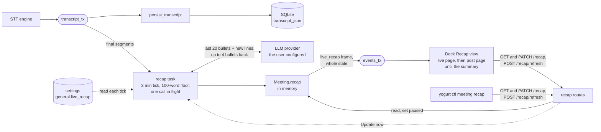
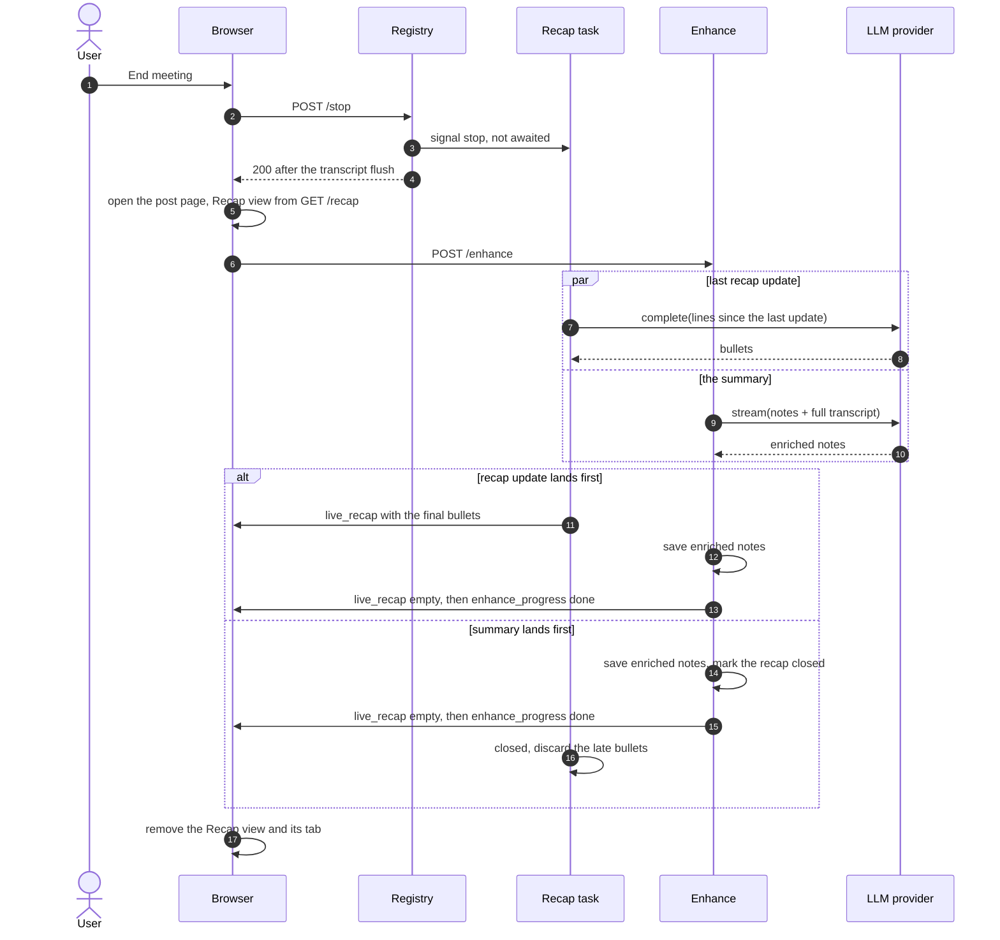

# Live recap

Planned. Written 2026-10-28.
Ticket: `docs/TODO.md` MTG-22.

During a meeting the live page shows the user's notes and a dock of raw transcript.
After a distraction, catching up means scrolling that transcript.
The live recap adds short bullets of what was just discussed, a few every 3 minutes, so the user can glance and rejoin.

Mocks, light and dark: [.lavish/live-recap-mocks.html](../.lavish/live-recap-mocks.html).
One question is still open, listed at the end.

## What the user sees

The transcript dock (`web/src/components/TranscriptDock.tsx`) gains a second view, Recap, beside Transcript.
A segmented control in the dock header switches between them, in place of today's "Live transcript" label.
Today's single edge tab becomes two stacked tabs, Recap and Transcript, and each opens the dock on its view.

Each bullet is one line of fact with the meeting time it came from, such as `05:55 Dana proposes $18/month, $180/year`.
Bullets follow the Enhance note style: decisions, numbers, owners, and open questions, with no narration and no quotes.
New bullets append at the bottom and earlier ones never change, so the list never jumps or rewrites itself while the user reads it.
Clicking a bullet switches the dock to Transcript and scrolls to that moment through `scrollToTranscriptTime` (`web/src/components/TranscriptLine.tsx:16`), the path the post-meeting timestamp links already use.

The dock never opens on its own, because the 330px panel overlays the notes column on a narrow window.
When bullets arrive while the dock is closed or on Transcript, a blueberry dot appears on the Recap tab until the user opens it.

The footer reads "Updated 1 min ago" and holds an Update now button, which runs an update at once instead of waiting for the next tick.
Before the first update the view reads "The recap starts after about 3 minutes of conversation."
While an update runs, a shimmer row sits under the last bullet.
A failed update keeps every earlier bullet, shows the error under them in the strawberry-soft style the STT error banner uses, and retries at the next tick.

With `general.live_recap` off, the dock is exactly today's dock: one Transcript tab and no Recap view.
Turning the setting off mid-meeting hides the Recap view on the next settings fetch.

### Pausing one meeting

With the setting on, the footer also holds a Pause button, so the user can stop the recap for one meeting without touching Settings, such as when a sensitive topic comes up.
While paused, the bullets so far stay in the view, a line under them reads "Paused for this meeting. Nothing said from here is sent until you resume.", and the footer shows Resume in place of Update now and Pause.
Resume picks up from that moment.
What was said while paused is never sent, not at the next tick, not at Resume, and not in the last update at End.
The pause belongs to the meeting, so it survives a page refresh and a Stop and resume of the recording, and the next meeting starts unpaused.

## How it runs

### The recap task

`Registry::start` (`crates/yogurt-server/src/meetings.rs:595`) spawns a recap task beside `persist_transcript`, and `stop` ends it the same way.
It subscribes to `transcript_tx` and buffers final segments since the last update.
Server-side is the right home because the recap keeps going when the browser tab closes, two open tabs do not double the calls, and `yogurt ctl` can read it.

While recording, every 3 minutes the task checks four things and runs an update only when all hold:

- `general.live_recap` is on, read at each tick so turning it off stops the next call.
- The meeting's recap is not paused.
- At least 100 new words arrived since the last update, so silence and small talk cost nothing.
- No update is already in flight. A CLI provider can take over a minute (`GENERATION_TIMEOUT` is 300s in `crates/yogurt-llm/src/lib.rs:27`), so with one the effective interval stretches to the call time.

Update now skips the word floor but keeps the other three checks.
While the setting is off or the meeting is paused, the task drops final segments as they arrive instead of buffering them, which is what keeps paused speech from ever reaching the provider.
It reaches the task through a `tokio::sync::Notify` on `Meeting`.

### The prompt

A new template, `crates/yogurt-prompts/templates/live-recap.md`, rendered by a new `render_live_recap`.
It gets the last 20 bullets as context and the new transcript lines in the `[mm:ss] me|them: text` form that `transcript_lines` (`crates/yogurt-server/src/api/chat.rs:295`) already produces, which moves into `yogurt-prompts` so both callers share it.
It asks for at most 4 new bullets, each written `- [mm:ss] fact`, covering only the new lines and repeating nothing from the earlier bullets, or `(none)` when nothing new was said.
Capping the context at 20 bullets keeps each call about the same size however long the meeting runs.

The call uses `complete()`, since a handful of short lines gains nothing from streaming, bounded by `llm.response_timeout()` and resolved through `llm_openai::resolve` like Enhance.
The reply goes through `strip_model_reasoning` (`crates/yogurt-server/src/enhance.rs:682`), and a line that does not parse is dropped.
A timestamp outside the window it summarized clamps to the window's first segment, so a bullet never points at a moment the model did not see.

### State and the wire

Bullets live in memory on `Meeting` as `recap: Mutex<RecapState>`, holding the bullets, a status (`idle`, `updating`, or `error`), the last error, the last update time, and whether the meeting is paused.
The registry keeps a meeting while it is live, so a page refresh keeps the recap.
A server restart ends the recording anyway, so nothing is lost that the recording itself does not lose.
No migration, which also keeps clear of the shared-database hazard a new column brings while the branch is in review.

Every state change sends a `live_recap` frame on `events_tx`, a new `WsEvent::LiveRecap` variant in `crates/yogurt-server/src/ws.rs`, carrying the whole state.
The list stays short, so sending all of it keeps a reconnecting page correct with no delta logic, the choice Enhance streaming made for the same reason.
`GET /api/meetings/{id}/recap` returns the same JSON, which the dock fetches on mount before the first frame arrives.
`POST /api/meetings/{id}/recap/refresh` is Update now, answering 202, or 409 when the meeting is not recording.
`PATCH /api/meetings/{id}/recap` with `{"paused": true}` or `false` is Pause and Resume, answering with the new state and sending it as a `live_recap` frame so every open tab agrees.
`yogurt ctl meeting recap <id>` prints the bullets, `--refresh` runs an update first, and `--pause` and `--resume` call the `PATCH`.

### The setting

`general.live_recap` is a key in the existing key-value settings (`crates/yogurt-db/src/settings.rs:34`), so it needs no migration.
General settings (`web/src/components/settings/GeneralSection.tsx`) gains "Show a live recap of the discussion while recording" after the auto-stop checkbox.
The line under it names the configured model and says the recap sends the latest few minutes of transcript to it every 3 minutes.

## After the meeting

The recap stays on screen until the summary is ready, then goes away.
Enhance can take a minute or more, especially with a CLI provider, and the recap is the only digest of the meeting during that wait.

End meeting stops the recording.
`stop` signals the recap task the way it signals `persist_transcript`, and the task runs one last update over whatever arrived since the previous one, with no word floor, then exits.
It skips that update when the meeting is paused or the setting is off.
`stop` does not wait for that call, so the post-meeting page opens as fast as it does today.
The last update runs alongside Enhance against the same provider, which is two requests at once for an HTTP provider and two processes at once for the CLI provider.

The post-meeting page (`web/src/routes/MeetingPost.tsx:585`) renders the dock in static mode from the saved transcript.
It gains the Recap view whenever the meeting has bullets, read from `GET /recap` on mount and kept current by `live_recap` frames on the per-meeting WebSocket the page already opens for `enhance_progress`.
If the dock was open on Recap when the user clicked End, the page opens it on Recap again, passed through the same navigation state that carries `autoEnhance`.
The view drops the connected dot and Update now, and its footer reads "Final recap · the summary replaces it when ready".

When Enhance has saved the enriched notes (`crates/yogurt-server/src/enhance.rs:565`), it clears the recap and marks it closed before it sends `enhance_progress: done`.
The page then gets an empty `live_recap` frame and removes the Recap view and its edge tab.
A dock showing Recap at that moment closes, so the summary it stood in for is in view.
The server decides when the recap ends and the page follows the frames, so the page needs no rule of its own about Enhance phases.

A few edges follow from that order:

- The closed mark discards a last update that finishes after the summary, so a slow recap call cannot bring the bullets back.
- A failed Enhance keeps the recap, because no summary has replaced it, and the next Enhance that succeeds clears it.
- A meeting too short to enhance has no bullets to clear, since the recap never got past its word floor.
- Re-enhance on an older meeting finds nothing to clear.
- Stop recording without End keeps the recap, so resuming continues it.
  Resuming after Enhance starts a fresh one, because that meeting is enhanced again at its end.

The registry keeps a meeting in memory until restart (`crates/yogurt-server/src/meetings.rs:279`), so the clear is what actually ends the bullets.
They never reach SQLite, the markdown export, or Yogurt Cloud, so they are never part of the meeting record.

## Privacy

The recap sends transcript text only to the LLM provider the user configured, which the hard constraints in `AGENTS.md` already allow.
The live Ask chat already sends the transcript to that provider mid-meeting, whenever the user asks.
What is new is that the recap sends on a timer rather than on a click, which is why it has its own setting and the setting names the model.
Audio never leaves the Mac for this.

## Cost

An estimate, not a measurement.
At about 150 spoken words a minute, 3 minutes of transcript is about 450 words, or about 600 tokens.
With 20 earlier bullets and the instructions, each call sends about 1,400 tokens and gets back about 80.
A one-hour meeting runs at most 20 updates, or about 28,000 input tokens.
Quiet stretches below the 100-word floor skip their tick and cost nothing.

## Testing

`yogurt-prompts` tests the new template's render and the bullet parser: well-formed lines, `(none)`, reasoning stripped, lines that do not parse, more than 4 bullets, and a timestamp outside the window.
A server test drives a meeting through the mock client in `llm_mock.rs`.
It covers the word floor, a refresh, an error that keeps earlier bullets, the setting turned off between ticks, the single in-flight guard, and the `live_recap` frame and `GET` agreeing.
For pause it checks that speech during a pause never appears in any prompt the mock receives, at a tick, at Resume, or in the last update at End, and that the pause survives a Stop and resume.
Vitest covers the dock's two views, the unseen dot, a bullet click switching to Transcript at the right line, Pause and Resume, and the plain Transcript-only dock with the setting off.
Playwright screenshots the dock in light and dark for the PR.
`just test-hw` with a real meeting checks the timing end to end, since the 3-minute tick only shows its behavior in a real recording.

## Docs

- `docs/FEATURES.md`: a Live recap row with its route, its ctl command, and its tests.
- `docs/AI-INTEGRATION.md`: the two new routes and the `live_recap` frame.
- `docs/ARCHITECTURE.md`: the recap task beside transcript persistence.

## Decided, push back if wrong

- The name is Recap, in the dock and in the setting.
- 3 minutes and 100 words, as constants and not settings, until real meetings say otherwise.
- Bullets are append-only and earlier ones never change.
- The prompt sees the transcript but not the user's notes, so the recap covers the conversation and nothing else.
- The recap lives in the dock as a second view, and a card above the notes was considered and dropped.
- The dock never opens itself, and a dot signals new bullets instead.
- Pause is per meeting and lives in memory, so it needs no setting and no migration.
- Speech during a pause, or with the setting off, is dropped and never summarized later.
- The bullets stay through Enhance and are dropped once the summary is saved, never kept with the meeting.
- The CLI provider is allowed, with the longer effective interval described above.

## Open questions

1. **Whether the setting starts on or off.**
   On means the feature is there the first time the user records, which is when it is worth anything.
   Off means upgrading users get no new background flow of their transcript to a provider without choosing it, which fits a local-first product.
   I lean toward on, because the transcript already goes to the same provider through Ask and Enhance and the setting names it, but this is a privacy default and the call is yours.
