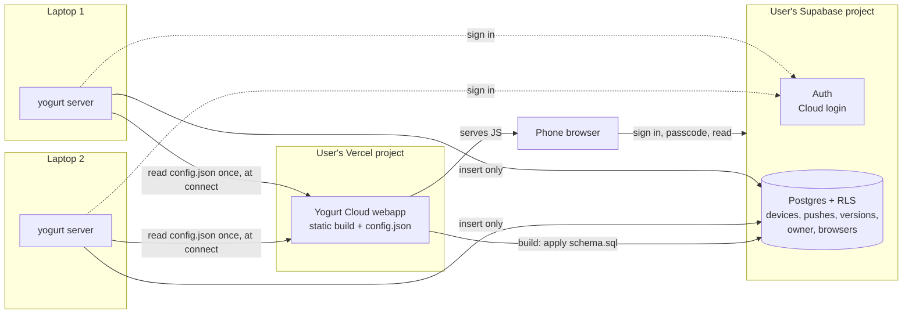
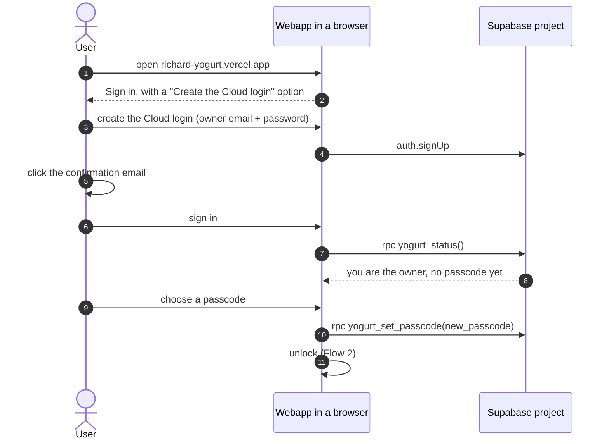
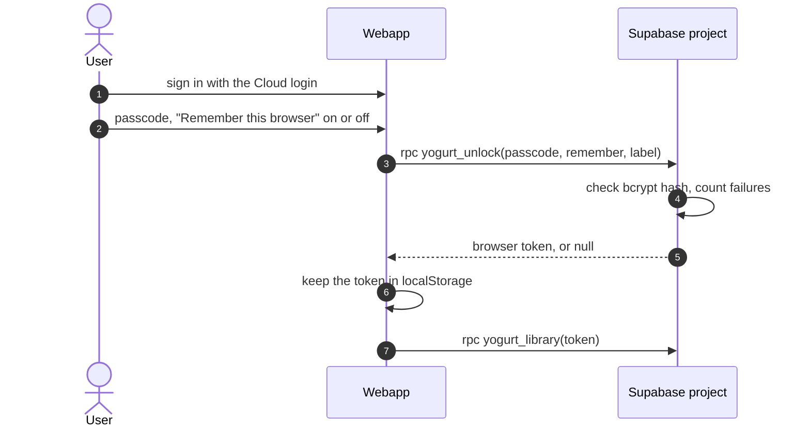
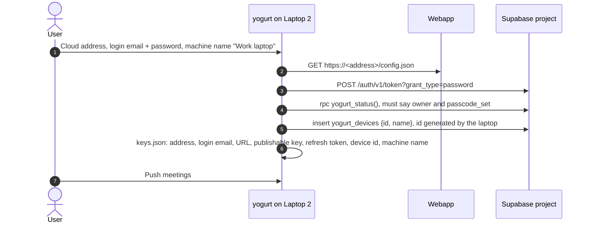
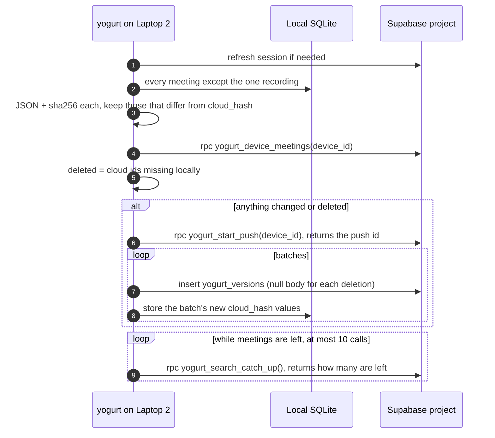

# SYNC: push meetings to a self-hosted cloud for reading on a phone

Design, partly implemented. SYNC-1 shipped an encrypted design that this revision replaces, and SYNC-2 removes what no longer applies.
Tickets: `docs/TODO.md` SYNC-2 through SYNC-7. Build order and verification: [sync-implementation-plan.md](sync-implementation-plan.md).
Review surface with diagrams and UI mocks: [../.lavish/sync-cloud-mirror-design.html](../.lavish/sync-cloud-mirror-design.html).

jarvisrchen runs yogurt on more than one laptop and wants to read every meeting from his phone.
Yogurt stays a local app with no login.
A new, optional Yogurt Cloud is a mirror that local installs push into and a webapp reads from.
Each user deploys their own Yogurt Cloud: a static webapp on their Vercel account, backed by a Supabase project they own.
No central yogurt server or database exists.

## Rules

- A local install works exactly as today with no account, and sync stays off until the user connects it in Settings.
- Yogurt Cloud is the user's own Vercel project and Supabase project. Yogurt ships the webapp, a SQL file, and a setup guide, and hosts nothing.
- Meetings are stored readable in the user's Supabase. There is no client-side encryption.
- Reading requires the Cloud login and a passcode, and Postgres enforces both.
- Sync is one-way. A laptop pushes and never reads meeting content back. The webapp is read-only.
- Every push is kept. The cloud is an append-only history, so any earlier push can be viewed again, and a client cannot change what a push older than one hour shows.
- Every meeting is pushed. There is no per-meeting exclusion.
- One owner per Yogurt Cloud. The schema keys every row by `user_id`, so a hosted multi-user cloud stays possible later.
- Out of scope: editing in the webapp, LLM chat in the webapp, recording in the webapp, sharing between people, conflict resolution, restoring from the cloud back onto a laptop.

## The cast

The walkthrough below uses one person with three machines and a phone.

- **Laptop 1** is the personal laptop. It may push its own meetings like any other laptop.
- **Laptop 2** and **Laptop 3** are other machines, possibly work laptops, each with its own local meetings to push.
- **The phone**, or any browser, reads everything through the webapp.

Setup happens in a browser, not on a laptop, so no laptop is special.

| Credential | What it is | Where it is used |
| --- | --- | --- |
| Vercel and Supabase accounts | The user's own logins that own the deployment and the database. | Once, during the deploy. Yogurt never sees them. |
| Cloud address | The webapp's URL, for example `richard-yogurt.vercel.app`. Not secret. | Typed on each laptop to connect, opened on the phone. |
| Cloud login | An email and password user inside the Supabase project. | Every laptop and every browser signs in with it. |
| Passcode | A second secret, a 4 or 6 digit PIN, checked in Postgres before any read. | Typed in the webapp only. Never on a laptop. |

Local yogurt keeps no account of its own, as today.

## Architecture



The webapp has no server functions.
Its build applies `schema.sql` to the database and writes `config.json`, and after that Vercel only serves files.
Laptops and browsers talk to Supabase directly.

## Deploying a Yogurt Cloud

The user imports their own fork or copy of the yogurt repo into a new Vercel project with Root Directory `cloud`, and sets `SUPABASE_URL`, `SUPABASE_PUBLISHABLE_KEY`, `POSTGRES_URL_NON_POOLING`, and `YOGURT_OWNER_EMAIL` by hand.
`YOGURT_OWNER_EMAIL` is the email of the one Cloud login allowed to read and push.
Richard's own cloud is a Vercel project on the jarvisrchen Vercel account, imported straight from `jarvisrchen/yogurt` with the same settings, so it redeploys on every merge to `main`.
A fork or copy does not follow `main`, so it updates only when the user syncs it.
Yogurt Cloud has one user, so the guide has no Deploy with Vercel button, which nobody would have rehearsed.

The build runs `cloud/scripts/build.mjs`:

1. Write `config.json` with `{"v":1,"supabase_url":...,"publishable_key":...}`.
   Both values are public by design.
   The script reads `SUPABASE_URL` and `SUPABASE_PUBLISHABLE_KEY`, which the Supabase integration sets (Supabase's Vercel Marketplace page, checked 2026-10-25).
   A missing value fails the build with a message naming the variable.
2. Run the Vite build into `cloud/dist`.
3. On production builds only (`VERCEL_ENV=production`), connect with `POSTGRES_URL_NON_POOLING`, apply `crates/yogurt-cloud/schema.sql`, and upsert `YOGURT_OWNER_EMAIL` into `yogurt_owner`.
   This runs last, so a failed build never migrates production.
   The script drops any `ssl*` parameter from the URL and sets TLS itself, on without certificate verification for a remote host and off for localhost, because Supabase's CA is not in Node's trust store.
   Preview builds skip this step so an unmerged branch never changes the live schema.

`schema.sql` is idempotent, so every production deploy re-applies it and schema changes ship with the code that needs them.

## Flow 1: first visit to the webapp



The confirmation link returns to the webapp with a session, so after clicking it the user lands on the passcode screen without signing in again.
A first-visit browser has no session, so it cannot call `yogurt_status`, which only `authenticated` may execute.
The webapp therefore opens on Sign in with a "Create the Cloud login" option and calls `yogurt_status` only after sign-in.
The owner is the confirmed Supabase user whose email matches `yogurt_owner.email`.
The first time that user calls any owner RPC, `yogurt_owner.user_id` is pinned to their id, so a later account cannot take ownership even if the email is reused.
Email confirmation must stay on, which is Supabase's default, because the email match is the only thing that makes the first sign-up the owner.
Supabase's built-in mail service sends only to the project's team members, at 2 emails an hour, so the owner email should be the account email that owns the Supabase project. Custom SMTP, for example Resend, covers any other address.
Checked in SYNC-3: the members are the Supabase organization's team members, so on a reused project the owner email must belong to that organization or the confirmation is refused with `email_address_not_authorized`.
Inviting the owner email to the organization is the free fix, and custom SMTP is the other one.
GoTrue also rejects reserved domains such as `example.com` with `email_address_invalid` before any mail is tried.
Anyone else can sign up, because Supabase sign-ups stay on, but every policy and RPC checks the owner, so another account can neither read nor insert a row.

## Flow 2: unlocking a browser



`yogurt_unlock` returns a random 32-byte token and stores only its SHA-256 in `yogurt_browsers`, with the label (for example "Safari on iPhone"), a creation time, and an expiry.
A token lasts 12 hours, or 90 days with "Remember this browser".
Every read RPC takes the token and refuses a missing, expired, or forgotten one.
The passcode is a 4 or 6 digit PIN, and `yogurt_set_passcode` rejects anything else with `invalid_parameter_value` (22023) before it looks at `old`, so a rejected format never counts as a failure.
Five wrong passcodes in a row lock unlocking for 15 minutes, and each further run of five doubles the lockout (30 minutes, 1 hour, and so on, capped at 2^10 times 15 minutes).
A correct passcode resets both counts.
A wrong `old` in `yogurt_set_passcode` counts as a wrong passcode, and both functions share one counter and one lockout, so switching between them does not buy more tries.
`yogurt_unlock` returns null on a wrong passcode or during a lockout instead of raising, because a raised error would roll back the failure count with it.
`yogurt_set_passcode` returns false for the same reason.
A missing, expired, or forgotten token raises SQLSTATE 28000 (`invalid or expired browser token`), which PostgREST answers with 403.
A caller who is not the owner gets 42501 from every RPC except `yogurt_status`.
Lock in the webapp forgets the token in that browser.
The settings page lists every remembered browser with Forget.
Changing the passcode deletes every browser, including the current one, and the webapp then unlocks the current browser again with the new passcode.

A forgotten passcode is reset in the Supabase SQL editor by setting a new PIN directly:

```sql
update yogurt_owner set passcode_hash = extensions.crypt('<new pin>', extensions.gen_salt('bf')), passcode_length = null, failed_attempts = 0, consecutive_lockouts = 0, locked_until = null where id;
delete from yogurt_browsers where true;
```

The passcode is never unset while meetings exist, because `yogurt_start_push` refuses to run until a passcode exists.
That reset needs the Supabase dashboard, which is the point: the Cloud login alone cannot reset the passcode.

## Flow 3: a laptop connects

In yogurt's Settings, under Cloud sync, then Connect:



Connecting needs a passcode chosen in the webapp first.
If `yogurt_status` says `passcode_set` is false, the laptop says to choose a passcode in the webapp and stops.
`yogurt_start_push` enforces the same rule with SQLSTATE `PT412` (HTTP 412, "choose a passcode in the webapp first"), so no meeting data lands before the owner has a PIN.
The laptop never sees the passcode, a Supabase secret, or a Vercel or Supabase account.
The login email is kept in the same `keys.json` entry so the Connected page can show it and a dead session can be renewed with only the password.
The password itself is used once and dropped.
"Create a Yogurt Cloud" on the same page opens the setup guide in the browser.

A refresh token that Supabase has revoked or expired shows "Sign in again" on the Connected page with an inline password field, which signs in with the stored email and replaces the token.
Disconnect removes the `keys.json` entry.
It first offers one last push that marks every meeting from this device deleted, so the current library drops them while history keeps them.

## Flow 4: pushing

The Push meetings button in Settings runs one pass.
An Auto-push setting (off, 15m, 1h, 1d) runs the same pass from a timer that wakes every minute while Yogurt is running.
It starts Off on every new connection.
It pushes when the interval has passed since the last successful push, and a wake with nothing pending only stamps the time without touching the network.
It retries a failure after 5 minutes.
It stops after `session_expired`, `device_removed`, `not_owner`, or `passcode_not_set` until a sign-in, a connect, or a manual push clears the error.
Every pass holds a lock file beside `keys.json`, so two yogurt processes on one data dir never rotate the same refresh token at once.



Each meeting is one JSON document, `{"v":1,"meeting":{...},"chat":[...]}`, stored in `yogurt_versions.body`.
`meeting` is the local API's `Meeting` minus volatile fields, with labels reduced to `{id, name, color}`, so reordering labels or tagging another meeting does not change this meeting's hash.
Hashing the JSON catches every change, including label and chat edits that do not touch `meetings.updated_at`.
`yogurt_device_meetings` returns the ids of that device's live meetings and nothing else, so a laptop session can plan a push without read access to content.
`meetings.cloud_hash` is one new nullable column, so it needs the usual shared-DB migration care while the branch is unmerged.
A pass that changes nothing writes nothing.
If a batch fails, its meetings keep their old `cloud_hash`, so the next pass sends them again. A push row with no versions never shows in the history.

## Cloud schema

`crates/yogurt-cloud/schema.sql` is the source of truth. It is idempotent, and the build applies it on every production deploy.

| Table | Columns | Clients may |
| --- | --- | --- |
| `yogurt_owner` (one row) | `email`, `user_id`, `passcode_hash`, `passcode_length`, `failed_attempts`, `consecutive_lockouts`, `locked_until` | nothing directly. The build writes `email` with `crates/yogurt-cloud/owner.sql`, and RPCs do the rest. |
| `yogurt_browsers` | `id`, `token_hash`, `label`, `created_at`, `expires_at`, `last_used_at` | nothing directly |
| `yogurt_devices` | `id` (laptop-generated), `user_id`, `name`, `created_at` | insert `id`, `name` |
| `yogurt_pushes` | `id`, `device_id`, `user_id`, `pushed_at` | nothing directly. `yogurt_start_push` creates one, because `insert ... returning` needs `select`. |
| `yogurt_versions` | `meeting_id`, `push_id`, `device_id`, `user_id`, `body jsonb` (null marks a deletion), keyed by `device_id`, `meeting_id`, `push_id` | insert `meeting_id`, `push_id`, `device_id`, `body` |

The functions, all `security definer` with a fixed `search_path`, and each checking that the caller is the owner:

| Function | Who calls it | Returns |
| --- | --- | --- |
| `yogurt_status()` | webapp, laptop | a JSON object: `owner_email_set`, `is_owner`, `passcode_set`, `passcode_length` (the owner's PIN length when known, for drawing the boxes only), and `locked_until` (null unless locked). Callable by any signed-in user. |
| `yogurt_set_passcode(new_passcode, old_passcode)` | webapp | true when set. `old_passcode` is required once a passcode exists. A wrong `old_passcode` or a lockout returns false. Hashes with `extensions.crypt` and `gen_salt('bf')`. Deletes every `yogurt_browsers` row, and the webapp then unlocks the current browser again with the new passcode. |
| `yogurt_unlock(passcode, remember, label)` | webapp | a browser token as 64 hex characters, or null |
| `yogurt_lock(token)`, `yogurt_forget_browser(token, browser_id)` | webapp | true when a browser was removed |
| `yogurt_browsers(token)` | webapp | live browsers with label, times, and whether each is the caller's |
| `yogurt_start_push(device_id)` | laptop | the new push id. Raises `PT412` until a passcode exists, and `PT404` when the device is not the caller's. |
| `yogurt_device_meetings(device_id)` | laptop | live meeting ids for that device |
| `yogurt_library(token, at_push)` | webapp | for each live meeting on each device, the latest version at or before `at_push`, or now: `device_id`, `push_id`, `pushed_at`, `meeting_id`, `body`, ordered by `meeting_id` then `device_id` for paging |
| `yogurt_search(token, query, only_device)` | webapp | the live meetings matching the query, newest first, at most 25: `device_id`, `meeting_id`, `push_id`, `started_at`, `ended_at`, `title`, a `snippet`, and `more`, which is true when there were more matches |
| `yogurt_history(token)` | webapp | each push that has a version, newest first, with its device id and name, time, and changed and deleted counts |
| `yogurt_device_list(token)` | webapp | device ids, names, and creation times |

The `authenticated` role gets no `select` on any table, so the Cloud login alone cannot read a meeting through PostgREST. A plain `GET /rest/v1/yogurt_versions` answers 403 with code 42501.
It keeps column-level `insert` grants on `yogurt_devices` (`id`, `name`) and `yogurt_versions`, and these policies: a row's `user_id` must be the caller, the caller must be the owner, and a version can only join a push of its own device created in the last hour.
The policy checks call small `security definer` helpers in a `yogurt_private` schema that PostgREST does not expose, returning only a boolean, because a policy subquery runs as the caller, who has no `select`.
Every `yogurt_` function first loses `execute` for `public`, `anon`, and `authenticated`, and an explicit allowlist then grants it to `authenticated`: the RPCs and the three policy helpers.
`owner.sql` is the one statement the build runs with the owner email as `$1`: it inserts the `yogurt_owner` row, and a changed email applies only while `user_id` is still null.
Grants stay explicit because Supabase no longer grants new public tables to the API roles, and TRUNCATE is outside RLS.
The `yogurt_` prefix keeps these tables apart from anything else in a reused project.
PostgREST caps a response at 1,000 rows, so clients page `yogurt_library` with limit and offset.

## Search

Search runs in the database, because the webapp will not always hold every body, and a full library can pass the response cap and the free egress budget.
It covers the live library only, one row per live meeting, and the History view of an earlier push has no search field, because History is for recovery.
`yogurt_private.yogurt_search_index` holds one row per device and meeting: the raw title, the plain text of the notes, enhanced notes, and transcript in its original case and accents, a `tsvector` of both, and the signature the row was built with.
It has a GIN index on the `tsvector`, row security on, and no client grants, so only the `security definer` RPC reads it.
A foreign key from the row to its version cascades on delete, so purging a device in the SQL editor, or deleting the account, removes its text from search as well.

Search work never runs inside a push, because anything slow there fails the laptop's insert under the 8 second statement timeout of the `authenticated` role.
`yogurt_versions` has no trigger.
`yogurt_private.yogurt_search_catch_up(max_ms)` brings the index up to the latest versions instead.
It finds rows that are missing, outdated (built from an older push than the latest version), extra (the latest version is a deletion), or built with an older signature.
It repairs them one at a time until about `max_ms` has passed and returns how many still need it, so 0 means up to date.
It walks the latest version of each meeting in descending key order, which a backward scan of the versions primary key gives without a sort, and it only counts the rest once its time is up.
Each repair is one statement that reads the meeting's latest version itself, so a deletion that commits while a catch-up runs is never undone, and the upsert never lets an older push replace a newer one.
An advisory lock runs one catch-up at a time, so a call that starts after a push sees every row an earlier call wrote.
A row that fails is counted and passed over, so every call makes progress and a stuck row shows up in the count.
`public.yogurt_search_catch_up(max_ms default 2000)` wraps it for the owner and caps `max_ms` at 3 seconds, so a call stays well under the statement timeout even after waiting for another catch-up.

After every pass, including one that failed after some of its batches committed, the laptop calls `yogurt_search_catch_up` while it returns more than 0, at most 10 times.
A pass with nothing to push still calls it once, which costs one scan of the latest versions, so a push heals an index a deploy left behind.
The timer's idle wake makes no network call, so it does not call it.
A failure there is logged as a warning and never changes the push result or its error state.
A new push becomes searchable once the laptop finishes that catch-up, usually seconds later.
The build applies the schema in one transaction, then calls the private function as `postgres` in 2 second calls, each its own transaction, until it returns 0 or 100 calls have passed, and laptops finish whatever is left.

The signature is an md5 over the `unaccent` version, the configuration's dictionaries, and the bodies of the functions that build a row.
Each row stores the signature it was built with, so a changed signature makes every row stale and catch-up rebuilds them gradually, while the old rows keep answering searches.
Nothing truncates the table or refills it under a lock at deploy time.

Measured in postgres:16 under Docker on an M3 Max, with 1,500 meetings of 600 transcript segments each, about 78 KB of body per meeting, drawn from a 5,000-word vocabulary:

| What | Time or size |
| --- | --- |
| Indexing all 1,500 from empty | 13.1 s over 7 calls |
| A catch-up with nothing to do | 2 ms |
| A push of 100 edited meetings, then its catch-up | 105 ms, then 0.9 s in one call |
| Rebuilding every row after a signature change | 13.5 s over 7 calls |
| Searching a word every meeting has | 127 ms |
| Searching a word some meetings have | 63 ms |
| Index table, against 13 MB of versions | 44 MB: 28 MB of tsvector, 15 MB of GIN, 7 MB of compressed text |

The worst case puts a unique hash in every segment.
There the index table reaches 169 MB, with 95 MB of GIN, and the first fill takes 16.9 s.

`yogurt_private.yogurt_ts` is a text search configuration that copies `simple` and maps `unaccent` before it for words, so matching ignores case and accents while the stored text keeps both.
Every deploy applies its mapping again, so a change to the mapping reaches an existing project.
It stems nothing and drops no stop words, so names and non-English words match as typed.
It splits on spaces and punctuation only, so Chinese, Japanese, and Korean words inside a sentence match only when typed as the whole run.
The tsvector, the query, and `ts_headline` all use it, so a highlight lands on the original word.
If `unaccent` is installed in another schema, the schema step moves it to `extensions`, and otherwise it creates it there.
The plain-text step removes a transcript link's label whole and drops editor tags, markdown markers at line or word boundaries, and U+E000 and U+E001.
It decodes `&amp; &lt; &gt; &nbsp; &quot; &#39;` and leaves text such as `latency<target` and `2*3` alone.
The text search parser takes quadratic time on a long run joined by `_` or `-` with no spaces (a 60 KB run took 7 to 13 seconds), so the step puts a space after every 100 characters of a run without one.
It keeps the first 400,000 bytes, about the first 400,000 characters of English text, so a word only in the tail of a very long meeting is not found.
The parser keeps the punctuation that ends a URL, as in `example.com/a-b,`, so the tsvector and the query drop `. , ; : ! ? ) ] '` at the end of a word before parsing.
The configuration does not index the parser's tag tokens, so both also read `<` and `>` as spaces, and `<runbook>` or `List<Order>` matches by its words.
Text dense with URLs or hosts can pass the 1 MB tsvector limit, and such a meeting indexes its title alone instead of failing every catch-up.
Besides its words, the tsvector holds the pieces of each word joined by `@`, `.`, or `/`, so `acme` finds `jane@acme.com` and `docs.acme.com/q4`, while the whole email, host, URL, or file name still matches as typed.

`yogurt_search` folds curly quotes to straight ones, and turns a dash with a space or the edge on both sides (a spaced hyphen or a pasted bullet) and an en or em dash into a space.
It strips `https://` and `http://` and parses the whole input once with `websearch_to_tsquery`.
Quotes, `or`, and a leading minus work, and a query with no word outside an exclusion returns nothing.
The last lexeme matches as a prefix, so a half-typed word finds its meeting.
A last word with a hyphen before a letter becomes a phrase of its parts, so `follow-u` finds `follow-up` and `follow up` but not `follow along and update`, while `ABC-123`, `2024-01-15`, and `555-0100` match as typed.
The phrase skips a last word that is excluded, quoted, or holds `@`, `.`, or `/`, so `-follow-up`, `jane-doe@example.com`, `my-company.com`, and `q4-report.pdf` stay whole.
A meeting whose latest version is a deletion is left out even before catch-up removes its row, since a deletion should take effect at once.
Rows come newest first with fixed tiebreakers, filtered by device before the cap of 25, and the RPC reads one row past the cap to set `more`.
A title match returns a null snippet, and any other match returns a `ts_headline` of about 14 words with the matched words wrapped in U+E000 and U+E001.
Positions in a `tsvector` stop at 16,383, so a quoted phrase matches only in the first part of a very long meeting.

The webapp waits 250 ms after the last keystroke and shows "Searching…" until the answer to the current input arrives, with the previous answer (or the full library) dimmed and inert beneath it.
A previous answer with no hits stays too, so the next keystroke after a miss does not flash the whole library.
A failed search shows only its error and Retry.
It renders the returned rows without needing them in the loaded library.
A hit opens the loaded copy at once.
When the loaded copy is older than the hit, the meeting page says "A newer version was pushed" with a Reload button.
When the loaded library lacks the meeting, the page shows its title and "This meeting isn't loaded on this page yet" with Reload.
Reload keeps the page on screen while the library loads again, and a failed reload shows its error with Retry.
The view as of an earlier push shows neither note.
SYNC-12 replaces this with a fetch of the one meeting.
It renders the snippet as text and marks the runs between the two characters, so meeting content is never parsed as HTML.

## History and reverting

The cloud keeps every push instead of one overwritten copy.
A push stores only the meetings that changed since that device's last push, plus a deletion marker for each meeting the device no longer has.
The library as of push N is the latest version of each meeting at or before N, which `yogurt_library(token, N)` returns.
Push ids are global across devices, so picking a push shows every device's library at that moment.

A full snapshot per push gives the same result at far higher cost.
With hourly auto-push, a 630 KB snapshot every hour is about 15 MB a day, which would fill the free tier's 500 MB in about a month.

Reverting is read-only, because sync is one-way.
The webapp's History list shows each push with its device, time, and changed and deleted counts, and picking one shows the library as it was then.
Nothing flows back to a laptop, and the next push continues from the laptop's local state.
That covers a local reset: a wiped `~/.yogurt/db.sqlite` with the connection intact makes the next pass mark every meeting from that device deleted, and they stay readable from any earlier push.

No client can update or delete a row, and history older than an hour is fixed.
Purging data for real, for example a work laptop's meetings, is done in the Supabase SQL editor.

Size check against the current `~/.yogurt/db.sqlite`: 45 meetings total 630 KB, and the largest (1 hour 58 minutes) is 148 KB.
An average version is about 14 KB, so the free tier's 500 MB holds about 35,000 versions.

### Pruning (SYNC-14, planned)

History keeps 30 days.
A daily `pg_cron` job keeps, for each meeting, every version from the last 30 days plus the newest version before that, which is the meeting as it stood 30 days ago, and drops the rest.
If that pre-window version is a deletion marker, the job drops it too, so a deleted meeting is gone for good 30 days after its deletion.
A live meeting always keeps its current version, however old.
The window is counted in days rather than pushes, because pushes need only a laptop's login: a stolen laptop token could otherwise push junk until real history aged out.

The webapp adds a Recently deleted list in settings, with Delete forever for a meeting whose latest version is a deletion marker.
It calls `yogurt_purge_meeting(token, meeting_id)`, which removes every version of that meeting and needs a PIN-unlocked browser token, so a laptop cannot call it.
A meeting that still exists on a laptop is not offered, because the next push would upload it again.

## Who can read what

| | Cloud login | Passcode | Can read meetings |
| --- | --- | --- | --- |
| A laptop | refresh token in `keys.json` | never | no. It can insert, and list its own meeting ids. |
| A browser after unlock | session | a browser token for 12 hours or 90 days | yes |
| Someone with the email and password | yes | no | no |
| The Supabase dashboard, its owner, or Supabase staff | n/a | n/a | yes, the data is stored readable |

Laptop secrets live in `~/.yogurt/keys.json` (mode 0600, `FileKeyStore`), never in SQLite or a log.

IT on a work laptop can take the laptop's refresh token, or the email and password if they were typed there.
Either one lets them add junk rows, deletion markers, or forged meetings in new pushes.
Neither lets them read a meeting, because every read needs the passcode, which is only ever typed into a browser.
They cannot erase history, so picking a push from more than an hour before the damage shows the real library.

The passcode does not protect against anyone with access to the Supabase project itself.
The plaintext choice trades that away for a simpler build and for server-side search and LLM features later.
Debugging with an agent happens against a local or test Supabase with seeded meetings, never against the real project, so meeting content does not land in an agent transcript.

Some corporate networks block `*.supabase.co` or `*.vercel.app`, which would stop a work laptop from connecting or pushing, and nothing on yogurt's side fixes that.

## UI

The mocks are in the review surface linked at the top.

Yogurt Settings:

- **Cloud sync, nothing set up.** Two cards: "Create a Yogurt Cloud", which opens the guide in the browser, and "Connect to a Yogurt Cloud".
- **Connect.** Cloud address, login email, password, machine name.
- **Connected.** Machine name, Cloud address with Open and a QR code for the phone, Push meetings, last push result, Disconnect.
- **Library subtitle.** "46 meetings · all on this Mac" gains "· 3 not pushed" when connected and behind.

The webapp:

- **First visit.** Create the Cloud login, confirm the email, then choose a passcode.
- **Sign in, then Unlock.** Passcode with "Remember this browser".
- **Library** with the device picker, a read-only **meeting** page, and **History**, which shows the library as of a push under a "Viewing <time>" banner with a Latest button.
- **Settings** (a gear in the library header): the account and Sign out, Lock, Change PIN, remembered browsers with Forget, and History under Recovery.

## Webapp

The webapp is its own Vite app in a top-level `cloud/` folder, with its own `package.json`, and Vercel builds only that folder.
Nothing in `cloud/` is embedded in the yogurt binary.
It imports the existing markdown and transcript components and the `@theme` tokens from `web/src` through the Vite alias `@web`, and makes no calls to the local API.
It serves `web/public` (the favicon and app icons) as its public folder.
Those imports would resolve `react` from `web/node_modules`, so `cloud/vite.config.ts` sets `resolve.dedupe` for `react` and `react-dom` to keep one copy.
`web/src/index.css` does `@import "tailwindcss"`, and Vercel installs only `cloud/node_modules`, so the config also aliases `tailwindcss` to cloud's copy.
`cloud/src/index.css` imports the shared stylesheet and names the shared components Tailwind must scan with `@source`.
CI builds `cloud/` in its own job without installing `web/`, which is what Vercel sees.
There is no dev server, because `config.json` exists only in `dist`.
Run `pnpm build` and `vite preview` instead.
Auth screens follow the mocks, with two phone adjustments.
Text inputs use 16px so iOS does not zoom on focus, and keypad keys are 44px tall for touch.
The PIN is one real `<input inputmode="numeric" autocomplete="off">` under the digit boxes.
On a phone the on-screen keypad types and the boxes do not raise the native keyboard.
The choose and change screens use the native numeric keyboard instead, as in mock G.
Mock G has no "Remember this browser" control, so the browser that sets the first PIN unlocks with remember on, like the Unlock screen's default.
The browser token and the "Remember this browser" choice share one `localStorage` key, `yogurt-cloud-browser`, so Change PIN can unlock the current browser again the same way.
It downloads the current library from `yogurt_library` on open, which is fine at personal scale. When it gets slow, the upgrade is a cache that fetches only versions with a higher push id.
Email and password is the only sign-in in v1.

## Constraint changes

`AGENTS.md`'s first hard constraint becomes: audio never leaves the machine unless the user opted into cloud STT (then only audio), and notes and transcripts leave only when the user connects a Yogurt Cloud they deployed, and only to that cloud's Supabase project.
The other constraints are unchanged:

- Zero telemetry still holds, because sync sends nothing to yogurt or to any third party the user did not configure.
- The one-process rule still holds, because sync runs inside the server.
- The license rule still holds. `@supabase/supabase-js`, `pg`, and `qrcode` are MIT.

The archived PRD's "There is no Yogurt cloud" still holds too, because yogurt hosts nothing.

## Free tiers

Supabase, from its pricing and project-pausing pages (checked during SYNC-2's first attempt): 500 MB of database per project, 2 active free projects, and a pause after 7 days of low activity, where API calls count as activity. A paused project resumes by hand within 1 year. Pro at $25 a month never pauses.
Vercel's Hobby plan allows 100 deployments a day and 100 builds an hour, and cannot connect to a GitHub organization (Vercel's limits page, checked 2026-10-25).

## Phasing

1. **SYNC-2.** Rework the `yogurt-cloud` crate for this design: remove the crypto and link code, rewrite `schema.sql` with the owner, passcode, and read RPCs, and keep the REST client and the local test stack.
2. **SYNC-3.** The webapp shell on Vercel: build script, first visit, sign in, passcode, unlock, settings, and an empty library.
3. **SYNC-4.** Connect, manual push, disconnect, the `cloud_hash` migration, and the `AGENTS.md` edit.
4. **SYNC-5.** The webapp's library, device picker, meeting page, and History.
5. **SYNC-6.** Automatic push on an interval (15 minutes, 1 hour, or daily).
6. **SYNC-7.** The setup guide, `docs/CLOUD-SYNC.md`, with the deploy button, checked by a rehearsal on real accounts.

[sync-implementation-plan.md](sync-implementation-plan.md) has the files, tests, and verification for each.

Later and unplanned: a hosted Yogurt Cloud, so other people could sign up at one URL without deploying their own.
That drops the single-owner check in favor of `user_id` isolation alone, which every table already has.
Holding other people's meetings readable is a different promise than holding your own, so that step reopens the encryption question.
LLM features over the cloud are also unplanned, and a Vercel function is the likely route.

## Decisions

Settled 2026-10-24.

- No client-side encryption. The passcode gate in Postgres covers the stolen-credential case, and the Supabase project owner is trusted.
- Each user deploys their own webapp on Vercel. The Cloud address replaces the link code.
- One set of tables keyed by `device_id`, rather than a table per machine.
- Setup happens in the browser through the deploy, so no laptop needs a Supabase access token.
- Every meeting is pushed, with no per-meeting exclusion.
- A local reset marks that device's meetings deleted in the next push, and history keeps them readable.
