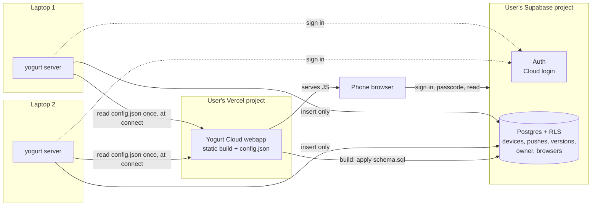
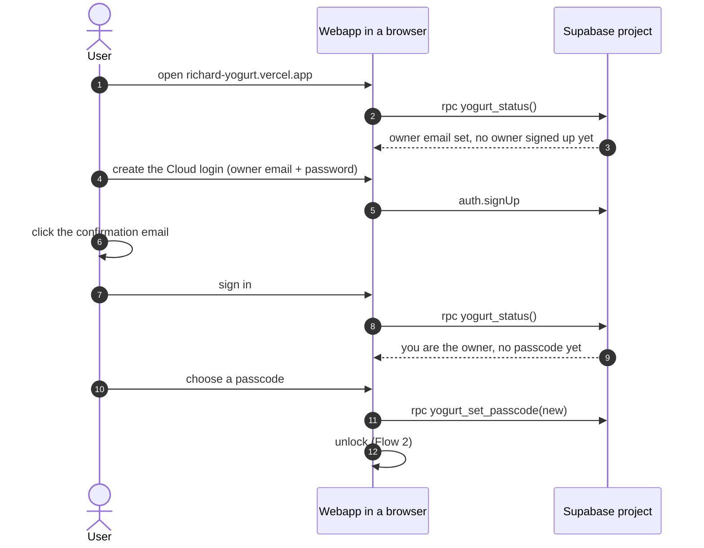
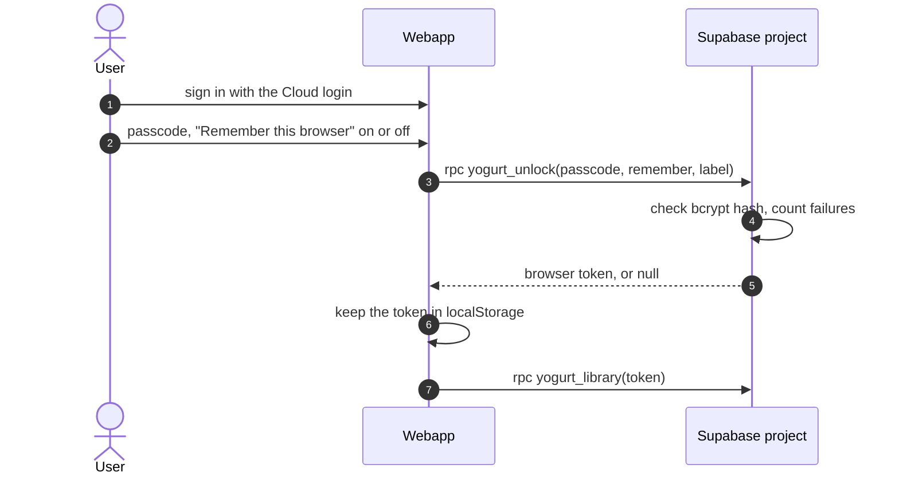
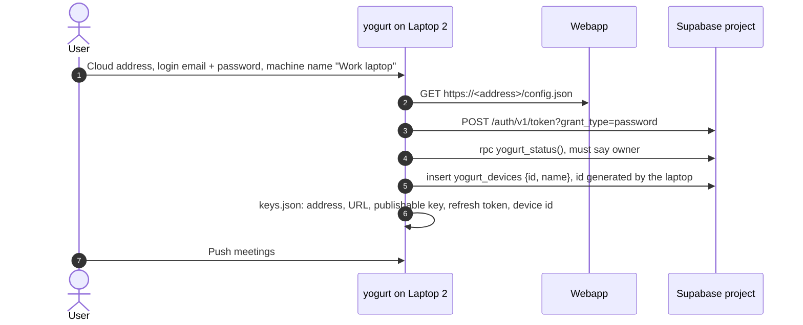
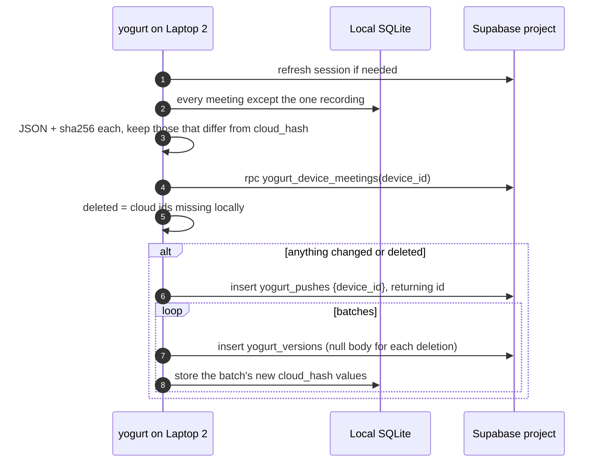

# SYNC: push meetings to a self-hosted cloud for reading on a phone

Design, partly implemented. SYNC-1 shipped an encrypted design that this revision replaces, and SYNC-2 removes what no longer applies.
Tickets: `docs/TODO.md` SYNC-2 through SYNC-7. Build order and verification: [sync-implementation-plan.md](sync-implementation-plan.md).
Review surface with diagrams and UI mocks: [../.lavish/sync-cloud-mirror-design.html](../.lavish/sync-cloud-mirror-design.html).

jarvisrchen runs yogurt on more than one laptop and wants to read every meeting from his phone.
Yogurt stays a local app with no login.
A new, optional Yogurt Cloud is a mirror that local installs push into and a webapp reads from.
Each user deploys their own Yogurt Cloud: a static webapp on their Vercel account, backed by a Supabase project they own.
No central yogurt server or database exists.

## Rules

- A local install works exactly as today with no account, and sync stays off until the user connects it in Settings.
- Yogurt Cloud is the user's own Vercel project and Supabase project. Yogurt ships the webapp, a SQL file, and a deploy button, and hosts nothing.
- Meetings are stored readable in the user's Supabase. There is no client-side encryption.
- Reading requires the Cloud login and a passcode, and Postgres enforces both.
- Sync is one-way. A laptop pushes and never reads meeting content back. The webapp is read-only.
- Every push is kept. The cloud is an append-only history, so any earlier push can be viewed again, and a client cannot change what a push older than one hour shows.
- Every meeting is pushed. There is no per-meeting exclusion.
- One owner per Yogurt Cloud. The schema keys every row by `user_id`, so a hosted multi-user cloud stays possible later.
- Out of scope: editing in the webapp, LLM chat in the webapp, recording in the webapp, sharing between people, conflict resolution, restoring from the cloud back onto a laptop.

## The cast

The walkthrough below uses one person with three machines and a phone.

- **Laptop 1** is the personal laptop. It may push its own meetings like any other laptop.
- **Laptop 2** and **Laptop 3** are other machines, possibly work laptops, each with its own local meetings to push.
- **The phone**, or any browser, reads everything through the webapp.

Setup happens in a browser, not on a laptop, so no laptop is special.

| Credential | What it is | Where it is used |
| --- | --- | --- |
| Vercel and Supabase accounts | The user's own logins that own the deployment and the database. | Once, during the deploy. Yogurt never sees them. |
| Cloud address | The webapp's URL, for example `richard-yogurt.vercel.app`. Not secret. | Typed on each laptop to connect, opened on the phone. |
| Cloud login | An email and password user inside the Supabase project. | Every laptop and every browser signs in with it. |
| Passcode | A second secret, checked in Postgres before any read. | Typed in the webapp only. Never on a laptop. |

Local yogurt keeps no account of its own, as today.

## Architecture

The webapp has no server functions.
Its build applies `schema.sql` to the database and writes `config.json`, and after that Vercel only serves files.
Laptops and browsers talk to Supabase directly.

## Deploying a Yogurt Cloud

The guide's Deploy with Vercel button opens Vercel's clone flow with these parameters, all documented on Vercel's deploy button pages (checked 2026-10-24):

- `repository-url` points at the yogurt repo, and `root-directory=cloud`.
- `stores` adds the Supabase Marketplace integration, which creates a new Supabase project and syncs `SUPABASE_URL`, `SUPABASE_PUBLISHABLE_KEY`, `POSTGRES_URL_NON_POOLING`, and other variables into the Vercel project (Supabase's Vercel Marketplace page, checked 2026-10-24).
- `env=YOGURT_OWNER_EMAIL` asks for the email of the one Cloud login allowed to read and push.

A user with an existing Supabase project skips the integration and enters `SUPABASE_URL`, `SUPABASE_PUBLISHABLE_KEY`, and `POSTGRES_URL_NON_POOLING` by hand.
Richard's own cloud is a Vercel project on the jarvisrchen Vercel account, imported straight from `jarvisrchen/yogurt` with the same settings, so it redeploys on every merge to `main`.
A deploy button copy is a new repo in the user's GitHub and does not follow `main`, so it updates only when the user syncs it.

The build runs `cloud/scripts/build.mjs`:

1. On production builds only (`VERCEL_ENV=production`), connect with `POSTGRES_URL_NON_POOLING`, apply `crates/yogurt-cloud/schema.sql`, and upsert `YOGURT_OWNER_EMAIL` into `yogurt_owner`. Preview builds skip this step so an unmerged branch never changes the live schema.
2. Write `config.json` with `{"v":1,"supabase_url":...,"publishable_key":...}`. Both values are public by design.
3. Run the Vite build into `cloud/dist`.

`schema.sql` is idempotent, so every production deploy re-applies it and schema changes ship with the code that needs them.

## Flow 1: first visit to the webapp

The owner is the confirmed Supabase user whose email matches `yogurt_owner.email`.
The first time that user calls any owner RPC, `yogurt_owner.user_id` is pinned to their id, so a later account cannot take ownership even if the email is reused.
Email confirmation must stay on, which is Supabase's default, because the email match is the only thing that makes the first sign-up the owner.
Anyone else can sign up, because Supabase sign-ups stay on, but every policy and RPC checks the owner, so another account can neither read nor insert a row.

## Flow 2: unlocking a browser

`yogurt_unlock` returns a random 32-byte token and stores only its SHA-256 in `yogurt_browsers`, with the label (for example "Safari on iPhone"), a creation time, and an expiry.
A token lasts 12 hours, or 90 days with "Remember this browser".
Every read RPC takes the token and refuses a missing, expired, or forgotten one.
Five wrong passcodes in a row lock unlocking for 15 minutes. The function returns null on a wrong passcode instead of raising, because a raised error would roll back the failure count with it.
Lock in the webapp forgets the token in that browser. The settings page lists every remembered browser with Forget, and changing the passcode forgets all of them except the current one.

A forgotten passcode is reset in the Supabase SQL editor: `update yogurt_owner set passcode_hash = null; delete from yogurt_browsers;`.
The next sign-in then asks for a new passcode, as in Flow 1.
That reset needs the Supabase dashboard, which is the point: the Cloud login alone cannot reset the passcode.

## Flow 3: a laptop connects

In yogurt's Settings, under Cloud sync, then Connect:

The laptop never sees the passcode, a Supabase secret, or a Vercel or Supabase account.
"Create a Yogurt Cloud" on the same page opens the setup guide with the deploy button in the browser.

Disconnect removes the `keys.json` entry.
It first offers one last push that marks every meeting from this device deleted, so the current library drops them while history keeps them.

## Flow 4: pushing

The Push meetings button in Settings runs one pass. SYNC-6 adds an interval timer that runs the same pass.

Each meeting is one JSON document, `{"v":1,"meeting":{...},"chat":[...]}`, stored in `yogurt_versions.body`.
`meeting` is the local API's `Meeting` minus volatile fields, with labels reduced to `{id, name, color}`, so reordering labels or tagging another meeting does not change this meeting's hash.
Hashing the JSON catches every change, including label and chat edits that do not touch `meetings.updated_at`.
`yogurt_device_meetings` returns the ids of that device's live meetings and nothing else, so a laptop session can plan a push without read access to content.
`meetings.cloud_hash` is one new nullable column, so it needs the usual shared-DB migration care while the branch is unmerged.
A pass that changes nothing writes nothing.
If a batch fails, its meetings keep their old `cloud_hash`, so the next pass sends them again. A push row with no versions never shows in the history.

## Cloud schema

`crates/yogurt-cloud/schema.sql` is the source of truth. It is idempotent, and the build applies it on every production deploy.

| Table | Columns | Clients may |
| --- | --- | --- |
| `yogurt_owner` | `email`, `user_id`, `passcode_hash`, `failed_attempts`, `locked_until` | nothing directly. The build writes `email`, and RPCs do the rest. |
| `yogurt_browsers` | `id`, `token_hash`, `label`, `created_at`, `expires_at`, `last_used_at` | nothing directly |
| `yogurt_devices` | `id` (laptop-generated), `user_id`, `name`, `created_at` | insert `id`, `name` |
| `yogurt_pushes` | `id`, `device_id`, `user_id`, `pushed_at` | insert `device_id` |
| `yogurt_versions` | `meeting_id`, `push_id`, `device_id`, `user_id`, `body jsonb` | insert `meeting_id`, `push_id`, `device_id`, `body` |

The functions, all `security definer` with a fixed `search_path`, and each checking that the caller is the owner:

| Function | Who calls it | Returns |
| --- | --- | --- |
| `yogurt_status()` | webapp, laptop | whether an owner email is set, whether the caller is the owner, whether a passcode is set |
| `yogurt_set_passcode(new, old)` | webapp | `old` is required once a passcode exists. Hashes with `extensions.crypt` and `gen_salt('bf')`. |
| `yogurt_unlock(passcode, remember, label)` | webapp | a browser token, or null |
| `yogurt_lock(token)`, `yogurt_forget_browser(token, id)`, `yogurt_browsers(token)` | webapp | |
| `yogurt_device_meetings(device_id)` | laptop | live meeting ids for that device |
| `yogurt_library(token, at_push)` | webapp | the latest version of each live meeting at or before `at_push`, or now, ordered by `meeting_id` for paging |
| `yogurt_history(token)` | webapp | each push with its device, time, and changed and deleted counts |
| `yogurt_device_list(token)` | webapp | device ids and names |

The `authenticated` role gets no `select` on any table, so the Cloud login alone cannot read a meeting through PostgREST.
It keeps the column-level `insert` grants and the SYNC-1 policies: a row's `user_id` must be the caller, the caller must be the owner, and a version can only join a push of its own device created in the last hour.
Grants stay explicit because Supabase no longer grants new public tables to the API roles, and TRUNCATE is outside RLS.
The `yogurt_` prefix keeps these tables apart from anything else in a reused project.
PostgREST caps a response at 1,000 rows, so clients page `yogurt_library` with limit and offset.

## History and reverting

The cloud keeps every push instead of one overwritten copy.
A push stores only the meetings that changed since that device's last push, plus a deletion marker for each meeting the device no longer has.
The library as of push N is the latest version of each meeting at or before N, which `yogurt_library(token, N)` returns.
Push ids are global across devices, so picking a push shows every device's library at that moment.

A full snapshot per push gives the same result at far higher cost.
With hourly auto-push, a 630 KB snapshot every hour is about 15 MB a day, which would fill the free tier's 500 MB in about a month.

Reverting is read-only, because sync is one-way.
The webapp's History list shows each push with its device, time, and changed and deleted counts, and picking one shows the library as it was then.
Nothing flows back to a laptop, and the next push continues from the laptop's local state.
That covers a local reset: a wiped `~/.yogurt/db.sqlite` with the connection intact makes the next pass mark every meeting from that device deleted, and they stay readable from any earlier push.

No client can update or delete a row, and history older than an hour is fixed.
Purging data for real, for example a work laptop's meetings, is done in the Supabase SQL editor.

Size check against the current `~/.yogurt/db.sqlite`: 45 meetings total 630 KB, and the largest (1 hour 58 minutes) is 148 KB.
An average version is about 14 KB, so the free tier's 500 MB holds about 35,000 versions.
If the database nears the cap, the upgrade is a `pg_cron` job that drops versions older than a set age while keeping each meeting's latest.

## Who can read what

| | Cloud login | Passcode | Can read meetings |
| --- | --- | --- | --- |
| A laptop | refresh token in `keys.json` | never | no. It can insert, and list its own meeting ids. |
| A browser after unlock | session | a browser token for 12 hours or 90 days | yes |
| Someone with the email and password | yes | no | no |
| The Supabase dashboard, its owner, or Supabase staff | n/a | n/a | yes, the data is stored readable |

Laptop secrets live in `~/.yogurt/keys.json` (mode 0600, `FileKeyStore`), never in SQLite or a log.

IT on a work laptop can take the laptop's refresh token, or the email and password if they were typed there.
Either one lets them add junk rows, deletion markers, or forged meetings in new pushes.
Neither lets them read a meeting, because every read needs the passcode, which is only ever typed into a browser.
They cannot erase history, so picking a push from more than an hour before the damage shows the real library.

The passcode does not protect against anyone with access to the Supabase project itself.
The plaintext choice trades that away for a simpler build and for server-side search and LLM features later.
Debugging with an agent happens against a local or test Supabase with seeded meetings, never against the real project, so meeting content does not land in an agent transcript.

Some corporate networks block `*.supabase.co` or `*.vercel.app`, which would stop a work laptop from connecting or pushing, and nothing on yogurt's side fixes that.

## UI

The mocks are in the review surface linked at the top.

Yogurt Settings:

- **Cloud sync, nothing set up.** Two cards: "Create a Yogurt Cloud", which opens the guide in the browser, and "Connect to a Yogurt Cloud".
- **Connect.** Cloud address, login email, password, machine name.
- **Connected.** Machine name, Cloud address with Open and a QR code for the phone, Push meetings, last push result, Disconnect.
- **Library subtitle.** "46 meetings · all on this Mac" gains "· 3 not pushed" when connected and behind.

The webapp:

- **First visit.** Create the Cloud login, confirm the email, then choose a passcode.
- **Sign in, then Unlock.** Passcode with "Remember this browser".
- **Library** with the device picker, a read-only **meeting** page, and **History**, which shows the library as of a push under a "Viewing <time>" banner with a Latest button.
- **Settings** (a gear in the library header): the account and Sign out, Lock, Change passcode, remembered browsers with Forget, and History under Recovery.

## Webapp

The webapp is its own Vite app in a top-level `cloud/` folder, with its own `package.json`, and Vercel builds only that folder.
Nothing in `cloud/` is embedded in the yogurt binary.
It imports the existing markdown and transcript components and the `@theme` tokens from `web/src` through a Vite alias, and makes no calls to the local API.
Those imports resolve `react` from `web/node_modules`, so `cloud/vite.config.ts` sets `resolve.dedupe` for `react` and `react-dom` to keep one copy.
It uses `@supabase/supabase-js` (MIT) for sign-in and session refresh, and reads `config.json` at startup.
It downloads the current library from `yogurt_library` on open, which is fine at personal scale. When it gets slow, the upgrade is a cache that fetches only versions with a higher push id.
Email and password is the only sign-in in v1.

## Constraint changes

`AGENTS.md`'s first hard constraint becomes: audio never leaves the machine unless the user opted into cloud STT (then only audio), and notes and transcripts leave only when the user connects a Yogurt Cloud they deployed, and only to that cloud's Supabase project.
The other constraints are unchanged:

- Zero telemetry still holds, because sync sends nothing to yogurt or to any third party the user did not configure.
- The one-process rule still holds, because sync runs inside the server.
- The license rule still holds. `@supabase/supabase-js`, `pg`, and `qrcode` are MIT.

The archived PRD's "There is no Yogurt cloud" still holds too, because yogurt hosts nothing.

## Free tiers

Supabase, from its pricing and project-pausing pages (checked during SYNC-2's first attempt): 500 MB of database per project, 2 active free projects, and a pause after 7 days of low activity, where API calls count as activity. A paused project resumes by hand within 1 year. Pro at $25 a month never pauses.
Vercel's Hobby plan covers a static site at personal scale. Verify its current limits before SYNC-7.

## Phasing

1. **SYNC-2.** Rework the `yogurt-cloud` crate for this design: remove the crypto and link code, rewrite `schema.sql` with the owner, passcode, and read RPCs, and keep the REST client and the local test stack.
2. **SYNC-3.** The webapp shell on Vercel: build script, first visit, sign in, passcode, unlock, settings, and an empty library.
3. **SYNC-4.** Connect, manual push, disconnect, the `cloud_hash` migration, and the `AGENTS.md` edit.
4. **SYNC-5.** The webapp's library, device picker, meeting page, and History.
5. **SYNC-6.** Automatic push on an interval (15 minutes, 1 hour, or daily).
6. **SYNC-7.** The setup guide, `docs/CLOUD-SYNC.md`, with the deploy button, checked by a rehearsal on real accounts.

[sync-implementation-plan.md](sync-implementation-plan.md) has the files, tests, and verification for each.

Later and unplanned: a hosted Yogurt Cloud, so other people could sign up at one URL without deploying their own.
That drops the single-owner check in favor of `user_id` isolation alone, which every table already has.
Holding other people's meetings readable is a different promise than holding your own, so that step reopens the encryption question.
Search and LLM features over the cloud are also unplanned. Postgres full-text search and a Vercel function are the likely routes, and neither needs a schema change beyond an index.

## Decisions

Settled 2026-10-24.

- No client-side encryption. The passcode gate in Postgres covers the stolen-credential case, and the Supabase project owner is trusted.
- Each user deploys their own webapp on Vercel. The Cloud address replaces the link code.
- One set of tables keyed by `device_id`, rather than a table per machine.
- Setup happens in the browser through the deploy, so no laptop needs a Supabase access token.
- Every meeting is pushed, with no per-meeting exclusion.
- A local reset marks that device's meetings deleted in the next push, and history keeps them readable.
