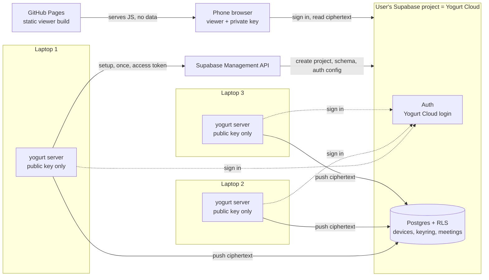
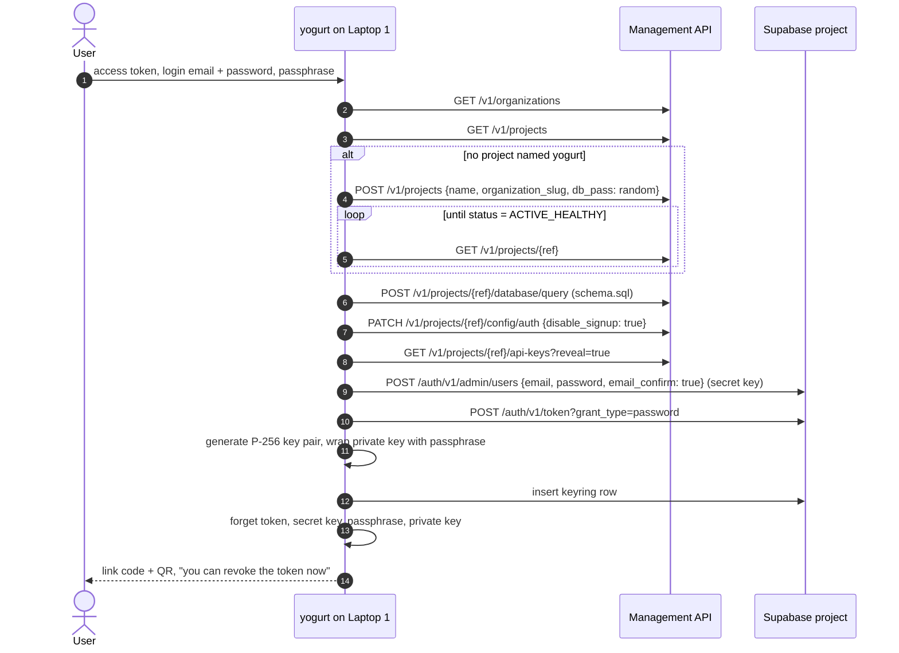
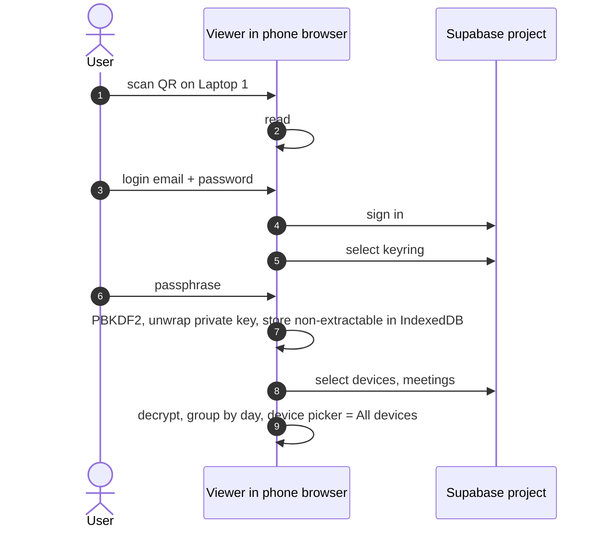
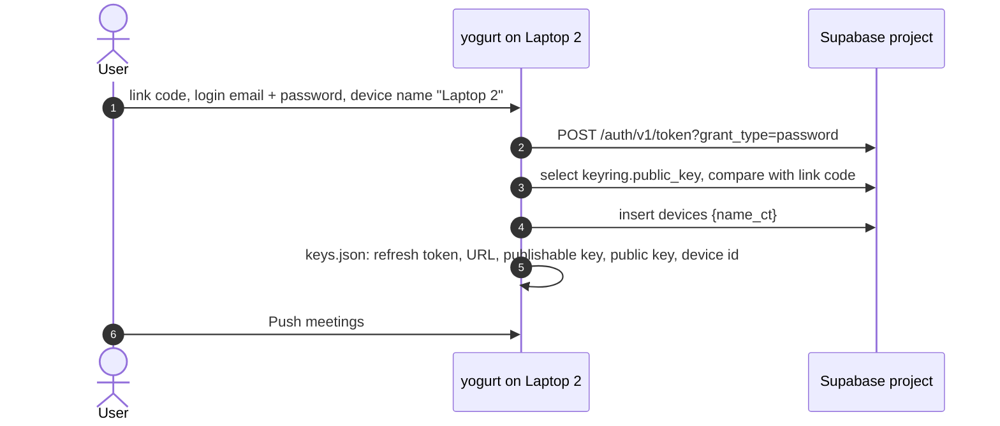
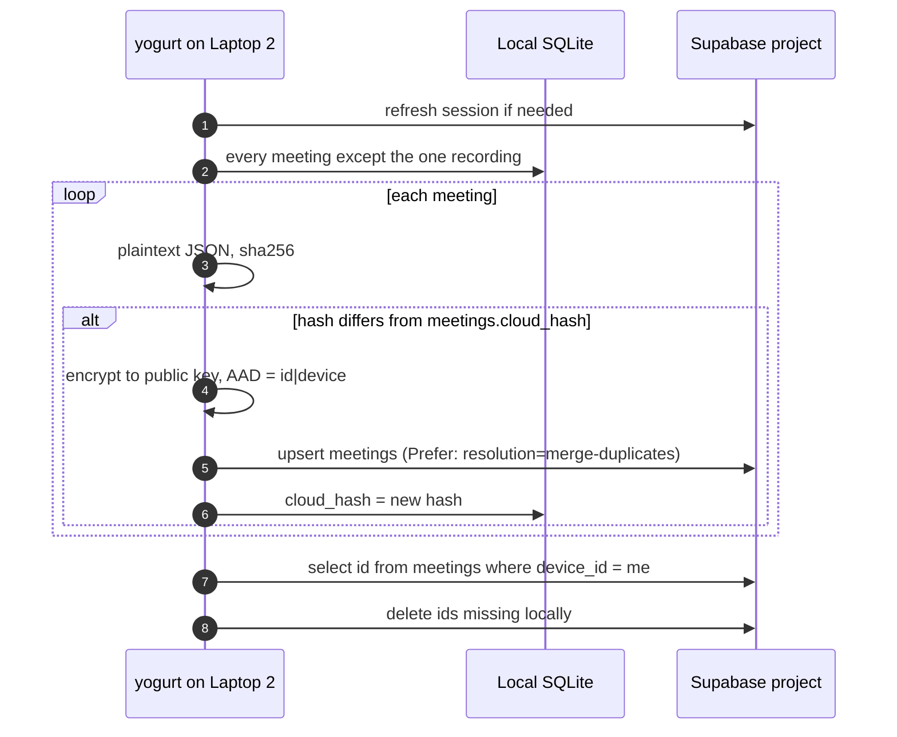

# SYNC: push meetings to a self-hosted cloud for reading on a phone

Design, not yet implemented.
Tickets: `docs/TODO.md` SYNC-1 through SYNC-3.
Review surface with diagrams and UI mocks: [../.lavish/sync-cloud-mirror-design.html](../.lavish/sync-cloud-mirror-design.html).

jarvisrchen runs yogurt on more than one laptop and wants to read every meeting from his phone.
Yogurt stays a local app with no login.
A new, optional Yogurt Cloud is a mirror that local installs push into and a phone reads from.
Each user hosts their Yogurt Cloud in their own Supabase project, so no central yogurt server or database exists.

## Rules

- A local install works exactly as today with no account, and sync stays off until the user turns it on in Settings.
- Yogurt Cloud is the user's own Supabase project. Yogurt ships the setup automation, a SQL file, and a static viewer, and hosts no data.
- Sync is one-way. A laptop pushes and never reads meeting content back. The phone is read-only.
- Supabase stores ciphertext only.
- Laptops can encrypt but never decrypt. Only the viewer, after the passphrase, can read.
- Out of scope: editing on the phone, LLM chat on the phone, recording on the phone, sharing between people, conflict resolution.

## The cast

The walkthrough below uses one person with three machines and a phone.

- **Laptop 1** is the personal laptop. It creates Yogurt Cloud once, and may also push its own meetings.
- **Laptop 2** and **Laptop 3** are other machines, possibly work laptops, each with its own local meetings to push.
- **The phone** reads everything.

Three credentials are involved, and each one shows up in as few places as possible.

| Credential | What it is | Where it is used |
| --- | --- | --- |
| Supabase account | The supabase.com login that owns the project and its billing. | Once, during setup on Laptop 1, through a personal access token held in memory. |
| Yogurt Cloud login | An email and password user inside the Supabase project. | Every laptop and the phone sign in with it. |
| Passphrase | Unlocks the private key that decrypts meetings. | Typed during setup on Laptop 1, and in the viewer. Never stored on a laptop. |

Local yogurt keeps no account of its own, as today.

## Architecture



Every arrow into Supabase carries ciphertext or credentials, never readable meeting content.
GitHub Pages serves code only and never sees the project details, because they travel in the link's `#fragment`.

## Encryption

Setup creates one P-256 key pair per Yogurt Cloud.
Laptops hold the public key and can only encrypt.
The private key lives in Supabase wrapped by the passphrase, and only the viewer unwraps it.
A stolen or IT-managed work laptop therefore exposes its own local meetings, which it already had, and nothing from the other machines.

| Piece | Choice |
| --- | --- |
| Account key pair | ECDH P-256. WebCrypto supports it in every current browser, and RustCrypto's `p256` crate covers the laptop. |
| Per-meeting encryption | A fresh ephemeral P-256 key, ECDH with the account public key, HKDF-SHA256 (`info = "yogurt-sync v1"`) to an AES-256-GCM key, and a random 96-bit nonce. |
| Blob format | `ct` is base64 of `ephemeral public key (65 bytes) || nonce (12 bytes) || ciphertext`. |
| Associated data | `"<meeting id>|<device id>"`, so a blob swapped between rows fails to decrypt rather than showing the wrong meeting. |
| Private key at rest | PKCS#8 bytes, AES-256-GCM under a key from PBKDF2-HMAC-SHA256 (600,000 iterations, 16-byte salt), stored in `keyring`. |
| Passphrase | 12 characters minimum, because the wrapped key sits in the database and anyone holding the login can attack it offline. |
| Plaintext | One JSON document per meeting: `{"v":1,"meeting":{...},"labels":[...],"chat":[...]}` with every `meetings` column, label names and colors, and chat messages. Device names are encrypted the same way, with the device id as associated data. |

The Rust side uses RustCrypto's `p256`, `hkdf`, `aes-gcm`, and `pbkdf2` crates, all MIT or Apache-2.0.
The viewer uses WebCrypto only, with no crypto library.
Checked-in fixtures produced by Rust (a wrapped private key and one encrypted meeting) are decrypted by a vitest test, so the two sides cannot drift.

`kdf` carries an `alg` field so a later move to Argon2id does not break existing clouds.
Changing the passphrase re-wraps the private key and re-encrypts no meetings.
A lost passphrase makes the cloud copy unreadable. Recovery is to wipe the cloud rows, run setup's "new key pair" step, and push again from each laptop, since every laptop still has its own local copy.

## Cloud schema

`cloud/schema.sql`, which setup runs automatically and which the manual fallback pastes into the SQL editor:

```sql
create table devices (
  id         uuid primary key default gen_random_uuid(),
  user_id    uuid not null default auth.uid() references auth.users on delete cascade,
  name_ct    text not null,
  created_at timestamptz not null default now()
);

create table keyring (
  user_id             uuid primary key default auth.uid() references auth.users on delete cascade,
  public_key          text  not null,  -- base64 raw P-256 point, not secret
  wrapped_private_key text  not null,
  kdf                 jsonb not null   -- {"alg":"pbkdf2-sha256","iter":600000,"salt":"<b64>"}
);

create table meetings (
  id        text primary key,  -- the local ULID
  device_id uuid not null references devices on delete cascade,
  user_id   uuid not null default auth.uid() references auth.users on delete cascade,
  ct        text not null,
  pushed_at timestamptz not null default now()
);

alter table devices  enable row level security;
alter table keyring  enable row level security;
alter table meetings enable row level security;
create policy own on devices  for all using (user_id = auth.uid()) with check (user_id = auth.uid());
create policy own on keyring  for all using (user_id = auth.uid()) with check (user_id = auth.uid());
create policy own on meetings for all using (user_id = auth.uid()) with check (user_id = auth.uid());
```

The only plaintext in the cloud is the login email, row ids, `pushed_at`, blob sizes, and the public key.
A schema without a version marker is v1. A later schema adds one when it needs it.

## The link code

Once a Yogurt Cloud exists, Settings shows a link code and a QR code.
Both carry the same three non-secret values: the project URL, the publishable key, and the public key.

- The link code is `yogurt-cloud:` followed by base64url JSON of those values. Laptops 2 and 3 paste it.
- The QR code is the viewer URL with the same payload in the fragment, `https://<viewer>/#c=<payload>`. Browsers never send the fragment to GitHub Pages.

The viewer's own settings page shows the link code too, so a new laptop can be connected from the phone without Laptop 1 nearby.

## Flow 1: Laptop 1 creates Yogurt Cloud (once)

The user signs up at supabase.com and creates a personal access token on the account tokens page.
Everything after that happens in yogurt's Settings, under Cloud sync, then "Set up a new Yogurt Cloud".



All endpoints above appear in the Management API's OpenAPI spec (`https://api.supabase.com/api/v1-json`, checked 2026-10-21).
`database/query` is marked Beta there, so if it fails, setup shows `schema.sql` with a copy button and a link to the project's SQL editor, then continues once the user confirms.
If the free plan's two-project cap blocks creation, setup offers the user's existing projects instead.
The random database password is never stored, because yogurt never connects to Postgres directly. The dashboard can reset it.

If Laptop 1 also records meetings, the same screen offers "Also push this laptop's meetings" with a device name, which runs Flow 3's last steps.

## Flow 2: the phone becomes the reader



Any browser can open the same viewer, Laptop 1's included.

## Flow 3: Laptops 2 and 3 connect

In yogurt's Settings, under Cloud sync, then "Connect to a Yogurt Cloud":



The public key check catches a link code from a different Yogurt Cloud than the login belongs to.
Laptop 2 never sees a Supabase token, a secret key, or the passphrase.

Disconnect removes those `keys.json` entries and offers to delete the device row, which cascades to every meeting it pushed.

## Flow 4: pushing

The Push meetings button in Settings runs one pass. SYNC-3 adds an interval timer that runs the same pass.



Hashing the plaintext catches every change, including label and chat edits that do not touch `meetings.updated_at`.
`meetings.cloud_hash` is one new nullable column, so it needs the usual shared-DB migration care while the branch is unmerged.
The id listing reads metadata only and no content.

Size check against the current `~/.yogurt/db.sqlite`: 45 meetings total 630 KB, and the largest (1 hour 58 minutes) is 148 KB.
With base64 and the 77-byte header, the free tier's 500 MB holds a few thousand two-hour meetings.

## What each place holds

| | Supabase access token | Cloud login | Public key | Private key |
| --- | --- | --- | --- | --- |
| Laptop 1 | in memory during setup only | refresh token, if it pushes | yes | in memory during setup only |
| Laptop 2, Laptop 3 | never | refresh token | yes | never |
| Viewer (phone or any browser) | never | session | yes | unwrapped, non-extractable, after the passphrase |
| Supabase | n/a | stores the login | stores it | wrapped by the passphrase |

Laptop secrets live in `~/.yogurt/keys.json` (mode 0600, `FileKeyStore`), never in SQLite or a log.

A compromised laptop still holds a cloud login.
It could upload junk or delete other devices' rows, but it cannot read them.
Local data is untouched, so pushing again from the other laptops restores the mirror.

Some corporate networks block `*.supabase.co`, which would stop a work laptop from pushing, and nothing on yogurt's side fixes that.

## UI

The mocks are in the review surface linked at the top.

- **Settings, Cloud sync, nothing set up.** Two cards: "Set up a new Yogurt Cloud" and "Connect to a Yogurt Cloud".
- **Setup.** Token, login, passphrase, then a checklist that ticks off each Flow 1 step, with the SQL fallback inline.
- **Connected.** Device name, Push meetings, last push result, link code with copy, QR for the phone, Disconnect.
- **Connect.** Link code, login, device name.
- **Library subtitle.** "46 meetings · all on this Mac" gains "· 3 not pushed" when connected and behind.
- **Viewer.** Unlock, library with the device picker, and a read-only meeting page.

## Viewer

A second Vite entry in `web/` (`web/cloud.html`) builds the static viewer.
It reuses the existing markdown and transcript components and makes no calls to the local API.
It uses `@supabase/supabase-js` (MIT) for sign-in and session refresh.
It downloads and decrypts every row on open. That is fine at personal scale. When it gets slow, the upgrade is an IndexedDB cache that fetches only rows with a newer `pushed_at`.

The default host is one public GitHub Pages build deployed from `main`.
Whoever controls that host controls the JS that sees decrypted meetings, so the docs also give a one-click deploy of the same build for anyone who wants their own copy.

Email and password is the only sign-in in v1.
Supabase's Google provider needs a Google Cloud OAuth client that setup cannot create, so it stays a manual, optional step in the docs.

## Constraint changes

`AGENTS.md`'s first hard constraint becomes: audio never leaves the machine unless the user opted into cloud STT (then only audio), and notes and transcripts leave only when the user connects a Yogurt Cloud in a Supabase project they own, and only as ciphertext the laptop itself cannot decrypt.
The other constraints are unchanged:

- Zero telemetry still holds, because sync sends nothing to yogurt or to any third party the user did not configure.
- The one-process rule still holds, because sync runs inside the server.
- The license rule still holds, because the new crates are MIT or Apache-2.0.

The archived PRD's "There is no Yogurt cloud" still holds too, because yogurt hosts nothing.

## Supabase free tier

Third-party sources agree on 500 MB of database per project, 2 free projects, and a pause after one week of inactivity that needs a manual restore.
Whether API writes count as activity is unverified.
Pro ($25 a month) removes the pause.
Verify against Supabase's own pricing page before SYNC-1 lands.

## Phasing

1. **SYNC-1.** `cloud/schema.sql`, the crypto with its fixtures, Flow 1 setup with the SQL fallback, Flow 3 connect and disconnect, the link code, manual push, the `cloud_hash` migration, and the `AGENTS.md` edit.
2. **SYNC-2.** The viewer, the QR code, and the GitHub Pages deploy.
3. **SYNC-3.** Automatic push on an interval (15 minutes, 1 hour, or daily).

## Open questions

- Should a meeting be excludable from push, for example a sensitive 1:1? The default pushes everything.
- After a local reset of `~/.yogurt/db.sqlite` with the connection still in `keys.json`, the next pass deletes that device's whole cloud copy. Is that right for a mirror, or should a pass refuse to delete when the local library is empty?
- Should the viewer remember the unlocked key per browser (the default) or ask for the passphrase every session?
- Should setup always create a fresh project, or always offer to reuse an existing one?
