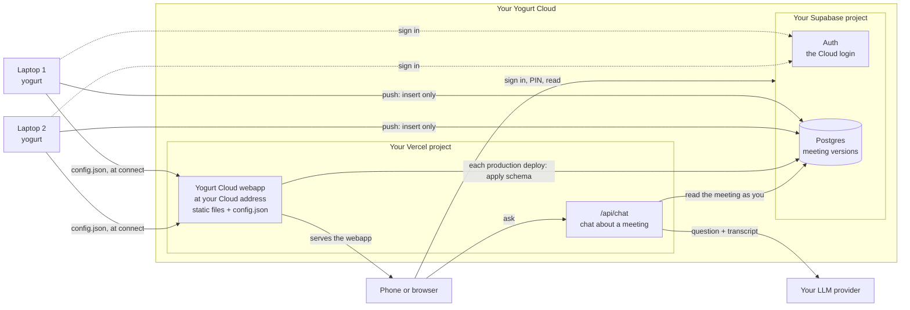
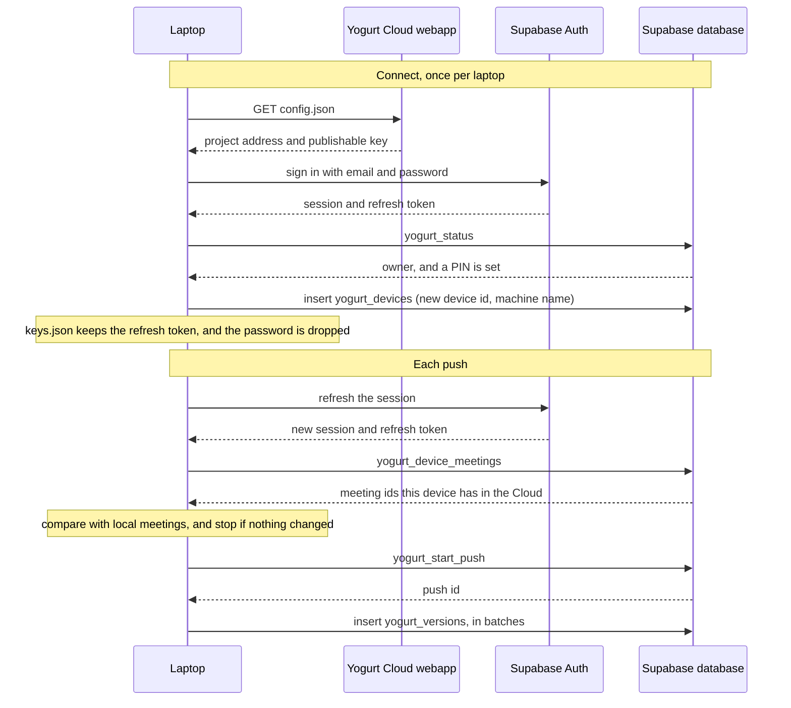
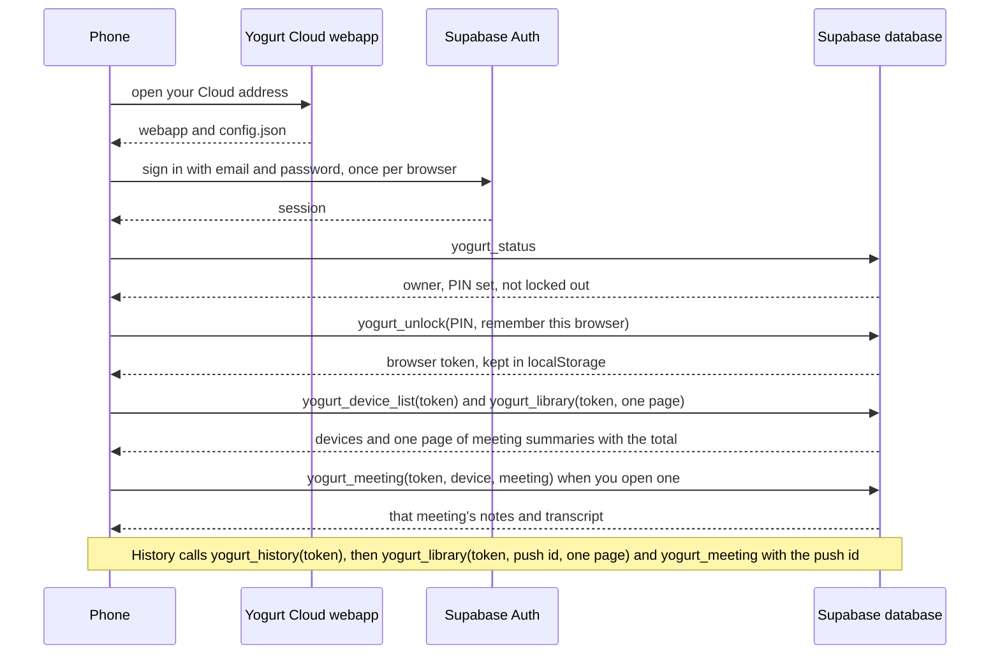

# Yogurt Cloud setup guide

Yogurt Cloud lets you read your meetings on your phone.
It is a webapp on your own Vercel account, backed by your own Supabase project.
Yogurt hosts nothing, and no meeting leaves your Mac until you press Push meetings in Settings or turn on Auto-push.
You need a Vercel account and a Supabase account, both free.
The design is in [docs/.planning/sync-cloud-mirror-design.md](.planning/sync-cloud-mirror-design.md).

## 1. How Yogurt Cloud works

### The parts

Your Yogurt Cloud is two projects you own, a Vercel project and a Supabase project.
Your laptops push to it, and your phone reads from it.

1. **The webapp, on your Vercel project.** This is the Yogurt Cloud you see.
   It lives at your Cloud address, for example `yogurt-cloud.vercel.app`, which you open on your phone and type into each laptop.
   It is static files plus one function, `/api/chat`, which answers questions about a meeting.
   Vercel sees a meeting only while that function answers a question about it, and keeps nothing.
2. **The data, in your Supabase project.** It holds a Postgres database with your meetings and a login service (Supabase Auth) with your Cloud login.
3. **Your laptops.** Each Mac running Yogurt pushes its meetings to your Supabase project.
4. **Your phone, or any browser.** It opens your Cloud address, signs in, and reads your meetings.



### How data moves

When you press Push meetings, your laptop signs in to your Supabase project with the Cloud login and sends meetings to its REST API.
Each pushed meeting is one JSON document with its title, times, labels, notes, enhanced notes, transcript, and chat messages.
Every push is insert only.
A push writes one new row (a version) for each meeting that changed since the last push, and a row with an empty body for each meeting you deleted on that laptop.
Nothing is ever updated or overwritten, so the cloud keeps the whole history.
The first push sends every meeting, and later pushes send only what changed.

When you connect, the laptop reads `config.json` from your webapp to find your Supabase project.
That file holds the project address and a publishable key, and both are public by design.



To read, your phone opens the webapp from Vercel.
You sign in with the Cloud login, then type your PIN.
Supabase checks the PIN in the database and hands the browser a token.
The webapp uses that token to call database functions (RPCs) that return your meetings.
The Cloud login alone cannot read a meeting.



The library call returns summaries only: title, times, starred, labels, and which machine pushed it.
A meeting's notes and transcript come from `yogurt_meeting` when you open it, so a library of thousands of meetings never downloads them all.

History works because versions are kept.
The library as of any earlier push is the newest version of each meeting at or before that push.

Vercel's only other job is the deploy.
Each production build applies the Yogurt database schema to your Supabase project and records the owner email.
A preview build skips that step, so an unmerged branch never changes your live schema.

### What leaves your Mac

Connecting sends the Cloud login email and password to your Supabase project to sign in, and registers the machine name.
After that, only meetings leave, and only when a push runs.
A push sends titles, notes, transcripts, and chat messages to your own Supabase project and nowhere else.
Audio never leaves your Mac for Yogurt Cloud.
API keys never leave either, because `keys.json` is not part of a push.
Yogurt sends nothing to Yogurt or to any third party you did not configure.

### Where the secrets live

- The laptop keeps the Cloud connection in `keys.json` in its data directory, `~/.yogurt/keys.json` by default, with mode 0600.
  It holds the Cloud address, the login email, the Supabase project address and publishable key, a refresh token, the device id, and the machine name.
  It never goes into the database or a log.
- The Cloud login password is used once to sign in and then dropped.
- The PIN is typed only into the webapp.
  It never reaches a laptop.
- A browser that unlocked keeps a token in its `localStorage`.
  The database stores only a hash of that token.
- The LLM API key for chat lives in your Vercel project's environment, marked Sensitive and limited to Production.
  The chat function never returns it or writes it to a log.

### The owner

Your Yogurt Cloud has one owner.
You name the owner by email when you deploy, in the `YOGURT_OWNER_EMAIL` variable.
The owner is the first confirmed Cloud login whose email matches that address.
The first time that login calls the database, Yogurt Cloud pins the owner to that Supabase user id.
After that, no other account can take over, even one that later signs up with the same email.
Anyone else may be able to create a login while sign-ups are on, but every table and function checks the owner, so that login can neither read nor write a meeting.

### Who can read what

| | Cloud login | PIN | Can read meetings |
| --- | --- | --- | --- |
| A laptop | refresh token in `keys.json` | never | No. It can insert, and list its own meeting ids. |
| A browser after unlock | session | a browser token for 12 hours, or 90 days with "Remember this browser" | Yes |
| Someone with the email and password | yes | no | No |
| The Supabase dashboard, its owner, or Supabase staff | n/a | n/a | Yes, because the data is stored readable |
| The chat function on Vercel | your session and browser token, sent with each question | n/a | Only the meeting you ask about, while it answers |
| Your LLM provider | n/a | n/a | The transcript of a meeting you ask about, with your questions |

Yogurt Cloud does not encrypt meetings on your Mac.
The PIN protects against a stolen Cloud login.
It does not protect against anyone with access to your Supabase project itself.

If IT controls a work laptop, they could take its refresh token, or the email and password if you typed them there.
That lets them add junk meetings or deletion markers in new pushes.
It does not let them read a meeting or erase history.
A push can only be added to for one hour, so the library as of a push from before the damage still shows the real data.
They could also type wrong PINs on purpose to lock you out, since each lockout doubles up to about 10 days.
[A forgotten PIN](#a-forgotten-pin) shows how to reset the PIN and clear the lockout from the Supabase dashboard.

## 2. Deploy your Yogurt Cloud

You do it in a browser, and no laptop is involved.

### Before you start

1. Create a Supabase account at [supabase.com](https://supabase.com) and note the email you used.
2. Create a Vercel account at [vercel.com](https://vercel.com) with a personal GitHub account.
   A Vercel Hobby account cannot connect to a GitHub organization, so use your personal account.
3. Decide the owner email.
   Use the email of your Supabase account.
   Supabase's built-in mail service sends only to members of your Supabase organization, so a confirmation sent to any other address is refused with `email_address_not_authorized`.
   If you must use another address, either invite it to your Supabase organization or set up custom SMTP, for example Resend, under Authentication in the Supabase dashboard.
   The built-in service also sends only 2 emails an hour, so do not retry the confirmation in a loop.

### Deploy

1. In the Supabase dashboard, create a project, or pick one you already have.
   All Yogurt tables start with `yogurt_`, so they stay apart from your other tables.
2. Fork or copy the Yogurt repository into your own GitHub account.
   In Vercel, select Add New, then Project, import that repository, and set Root Directory to `cloud`.
   This first deploy fails, because the variables are not set yet.
3. In your Vercel project, open Settings, then Environment Variables, and add the four variables in the table below the steps.
   Limit `POSTGRES_URL_NON_POOLING` to the Production environment and mark it Sensitive, because the build uses it only to apply the schema.

| Name | Value | Where to find it in Supabase |
| --- | --- | --- |
| `SUPABASE_URL` | the project URL | the Connect dialog, or Settings, then API Keys |
| `SUPABASE_PUBLISHABLE_KEY` | the key that starts with `sb_publishable_` | the Connect dialog, or Settings, then API Keys |
| `POSTGRES_URL_NON_POOLING` | the Session pooler connection string, on port 5432, with your database password filled in | Connect at the top of the project page, then Session pooler |
| `YOGURT_OWNER_EMAIL` | the owner email | your choice |

4. Redeploy the project so the build sees the variables.
   The build takes a minute or two.
   It writes the webapp's `config.json`, builds the webapp, then applies the database schema and records the owner email.
5. When the deploy finishes, copy the address Vercel shows, for example `yogurt-cloud.vercel.app`.
   This is your Cloud address.
6. In the Supabase dashboard, open Authentication, then URL Configuration.
   Set Site URL to your Cloud address, for example `https://yogurt-cloud.vercel.app`.
   Add the same address to Redirect URLs.
   Without this, the confirmation email link returns to the wrong address, such as `localhost`.
7. Confirm email must stay on, which is Supabase's default.
   The owner match depends on it.
8. Check the owner email against [Before you start](#before-you-start).

If the build fails, open the build log.
A message that starts with `yogurt-cloud build:` names the missing variable.

### Turn on chat

Chat answers questions about a meeting through any OpenAI-compatible chat completions API, the same kind of provider as an HTTP provider in Yogurt's Settings.
Add three more variables, limited to Production, and redeploy:

| Name | Value |
| --- | --- |
| `YOGURT_LLM_BASE_URL` | the API's base address, for example `https://api.minimax.io/v1` |
| `YOGURT_LLM_MODEL` | the model name, for example `MiniMax-M3` |
| `YOGURT_LLM_API_KEY` | the API key, marked Sensitive |

Until all three are set, chat answers "Chat isn't set up on this Cloud."
The local command-line providers, such as Claude Code, cannot run on Vercel.

The login settings apply to the whole Supabase project, so another app on the same project gets them too.
Its confirmation links would go to your Cloud address, and turning off sign-ups would block its new users.
Use a project of its own when another app signs users up on it.

### Free tiers

A Supabase free project pauses after 7 days of low activity, and API calls count as activity.
A push counts, but an auto-push check with nothing to push makes no network call, so auto-push alone does not keep a project awake.
[A paused Supabase project](#a-paused-supabase-project) shows how to wake it.
A free organization allows 2 active projects.
Vercel's Hobby plan allows 100 deployments a day and 100 builds an hour, far above what this project needs (Vercel's limits page, checked 2026-10-25).

## 3. First visit to the webapp

Open your Cloud address in a browser.
The first screen is Sign in.
Your first visit has no login yet, so follow these steps once.

1. Select Create your Cloud login.
2. Type the email you entered as `YOGURT_OWNER_EMAIL` when you deployed, and a password of at least 6 characters.
   Any other email can sign up while sign-ups are on, but it cannot read or push anything.
3. Select Create login.
   The webapp says "Check your email".
4. Open the confirmation email and select its link.
   The link returns to your webapp already signed in.
   If the webapp shows Sign in instead, sign in with the same email and password.
   If no email arrives, see Troubleshooting.
5. Choose a 4 or 6 digit PIN, type it again under Confirm PIN, and select Save PIN.
   You type this PIN in a browser to read meetings, and your laptops never see it.
   Unlock shows as many boxes as your PIN has digits.

The webapp then opens the library, which says "No machine has pushed yet" until you connect a laptop (section 4).

### Turn sign-ups off

Do this once you have a PIN and have opened your library.

1. Open the Supabase dashboard, then your project, then Authentication, then Sign In / Providers.
2. Turn off "Allow new users to sign up".

Nobody else can create a login after this.
The owner is already pinned, so your existing login keeps working on every browser and laptop.
If you ever need to create the owner login again, turn the setting back on first.
While it is off, Create login in the webapp says "This Cloud isn't taking new logins. Sign in with the owner account."

### Add the webapp to your phone

Add the webapp to your phone's home screen so it opens like an app.
In Safari on iPhone, select Share, then Add to Home Screen.
In Chrome on Android, open the menu, then Add to Home screen or Install app.
The icon is the Yogurt logo.

From then on, a browser that is already signed in only asks for the PIN.
Tick "Remember this browser" to stay unlocked for 90 days, or leave it unticked for 12 hours.
Five wrong PINs in a row lock unlocking for 15 minutes, and each further five doubles the wait, up to about 10 days.

## 4. Connect each laptop

Do this on every Mac that should push its meetings.
You need the Cloud address of your webapp and the Cloud login email and password.
You must have chosen a PIN in the webapp first, or Yogurt will say "Choose a PIN in the webapp first".

1. Open Settings, then Cloud sync.
   Under "Connect to a Yogurt Cloud", select Connect.
   The same page has "Create a Yogurt Cloud", which opens this guide.
2. Type the Cloud address, for example `richard-yogurt.vercel.app`.
   When you leave the field, Yogurt says "Found a Yogurt Cloud" if the address serves a Yogurt Cloud config.
3. Type the Login email and Login password, and a Machine name such as "Work laptop".
   The webapp's device picker shows the machine name.
4. Select Connect.
   Yogurt signs in once and keeps only a refresh token in `~/.yogurt/keys.json`.
   It never stores the password, and it never sees your PIN.

If the login does not own that Yogurt Cloud, Yogurt says "This login does not own that Yogurt Cloud".

Each connection registers a new device with a new id, even on a Mac that connected before.
The first push after it sends every meeting again, and the old device's meetings stay in the Cloud next to the new ones until you [purge](#purge-one-devices-data) the old device.

## 5. Everyday use

### Push your meetings

Select Push meetings on the Cloud sync page.
The push runs in the background and the button returns at once.
It sends meetings in small batches with a short pause between them, so a library of over a thousand meetings uploads in several minutes without overloading a free Supabase project.
A request that fails because the cloud is busy or unreachable is retried after 5, 15, 45, and 120 seconds, and the push stops only when those are used up.
Batches already sent are kept, so the next push picks up where this one stopped.
A push of more than one batch shows a pill at the top of every page ("Pushing to Cloud · 340 of 1,412", "Retrying in 45s", then "Pushed 1,412"), and the Cloud sync page shows the same count with a bar.
Only one push runs at a time.
The first push sends every meeting, and later pushes send only the meetings you changed, plus a deletion marker for each meeting you deleted.
The meeting you are recording right now is skipped until it ends.
The page shows how many meetings are not pushed and the result of the last push.

The Library header shows a "N not pushed" pill beside "N meetings · all on this Mac" while this Mac is connected and behind.
Select the pill to open the Cloud sync page.
You can also run `yogurt ctl cloud status` and `yogurt ctl cloud push` from a terminal.
`ctl cloud push` waits until the push ends and prints its result.

If the page says "Your Cloud session expired", type the Cloud login password into the field under the message and select Sign in.
Your meetings are not affected.

### Push automatically

The Auto-push control on the Cloud sync page chooses how often Yogurt pushes by itself: Off, 15 min, Hourly, or Daily.
It starts Off, and a new connection starts Off again, so nothing leaves this Mac until you choose an interval.
Yogurt checks once a minute while it is running.
It pushes when the interval has passed since the last successful push, or when nothing has been pushed yet.
Automatic and manual pushes never run at the same time, and the meeting you are recording is skipped as usual.
Yogurt must be running, because there is no background service.
A push missed while Yogurt was closed happens within a minute of the next start.

If an automatic push fails, the page shows the error under the last push, like a failed manual push.
Yogurt tries again after 5 minutes.
If the error is one only you can fix, such as "Your Cloud session expired" or "This machine was removed from the Yogurt Cloud", Yogurt stops trying.
It resumes after you sign in again, connect again, or push by hand successfully.
When nothing has changed, a check costs no network call.
`yogurt ctl cloud status` prints the interval on its `auto-push:` line.

## 6. Read on your phone

Open the webapp from the home screen, type your PIN, and select Unlock.

The library lists every meeting you pushed, grouped by day with the newest first, one page at a time.
Under the list, a range such as "26–50 of 1,412" shows where you are, Previous and Next move between pages, and Per page offers 10, 25, 50, or 100.
The page and the page size are in the address, so a reload or a shared link keeps them, and a size you pick is remembered.
The pills above the list pick one machine, and All devices shows them together.
Each row shows the title, the start time, the length, and the machine that pushed it.

The search field above the pills finds meetings by title, notes, enhanced notes, and transcript text as you type.
It searches the live library only, so an earlier push shown from History has no search field.
Capital letters and accents do not matter, quotes find a phrase, `or` finds either word, and a minus sign leaves a word out.
A row that matches outside its title shows a short snippet with the match marked.
Search works inside the selected machine, and the clear button or Escape restores the full list.
A search shows 25 matches a page, newest first, with Previous and Next under the list when there are more.
Chinese, Japanese, and Korean words inside a sentence do not match unless you type the whole run of characters.
Search reads only about the first 400,000 characters of a meeting, so a word only in the tail of a very long meeting is not found.
A quoted phrase matches only in the first part of a long meeting.
A new push becomes searchable once the laptop finishes indexing after the push, usually seconds later.

Tap a meeting to read it.
Its notes and transcript load when you open it, from the library or from a search result, and they are always the latest version.
The page is read-only and has a Notes, an Enhanced, and a Transcript tab.
A tab is missing when that meeting has no such content, and a meeting with one kind of content shows no tabs.
Enhanced opens first when the meeting has it.
A transcript link in the notes opens the Transcript tab, scrolls to the line nearest that time, and tints it briefly.
The footer says which machine pushed the meeting and when.

Ask this meeting, at the bottom of a meeting, opens a chat about it.
Your question and the meeting's transcript go to the LLM provider you set in [Turn on chat](#turn-on-chat), and the answer streams back.
The chat sees the transcript only, as the chat in Yogurt on your Mac does.
The conversation stays on the page: leaving the meeting or reloading clears it, and nothing is saved to your Cloud.
A meeting opened from an earlier push in History has no chat.

The address in the browser tracks where you are, so the back gesture goes from a meeting to the library, and a reload keeps your place.
A link to a meeting survives signing in and unlocking.

On a wide screen the library and the open meeting show side by side.

## 7. History and recovery

### See your library as of an earlier push

In Settings, under Recovery, select History.
It lists every push with its machine and time.
A row says how many meetings the push updated and removed.
Tap a row to see the library as it was right after that push, under a "Viewing" banner.
Meetings you open there show the version from that moment.
Latest returns to the live library.

Viewing is read-only.
Nothing flows back to a laptop, and the next push continues from the laptop's local state.

### A wiped laptop

What happens depends on what the wipe removed.

If only the database was wiped and `~/.yogurt/keys.json` is intact, the Mac is still the same device.
The next push finds every cloud meeting missing locally and marks them deleted.
The current library drops them, and History still shows them.

If the whole Mac or `keys.json` is gone, connect again from section 4.
The new connection is a new device, so the old device and all its meetings stay in your library and device picker as they were.
The same happens when you disconnect a laptop without marking its meetings deleted and connect it again later.
To remove the old device's data for real, purge it, as described below.

Yogurt cannot restore meetings from the cloud back onto a laptop.

### Purge one device's data

Purging is the only way to remove meetings for real, for example a work laptop's.
Do it in the Supabase SQL editor, because no client can update or delete a row.
Open the Supabase dashboard, then your project, then SQL Editor.

1. List your devices and copy the id of the one to remove.

```sql
select id, name, created_at from yogurt_devices order by created_at;
```

2. Delete its rows, in this order, replacing the id.
   Versions point to pushes and devices, and pushes point to devices, so the order matters.

```sql
delete from yogurt_versions where device_id = '00000000-0000-0000-0000-000000000000';
delete from yogurt_pushes where device_id = '00000000-0000-0000-0000-000000000000';
delete from yogurt_devices where id = '00000000-0000-0000-0000-000000000000';
```

This removes that device's meetings from the library and from search, and its pushes from History.
Other devices are untouched.
If that laptop is still connected, its next push says "This machine was removed from the Yogurt Cloud. Disconnect, then connect again."

### A forgotten PIN

The webapp cannot reset a forgotten PIN.
You reset it in the Supabase SQL editor, which needs your Supabase account.
This also clears a lockout.
Run this with your new 4 or 6 digit PIN in place of `1234`.

```sql
update yogurt_owner
set passcode_hash = extensions.crypt('1234', extensions.gen_salt('bf')),
    passcode_length = null,
    failed_attempts = 0,
    consecutive_lockouts = 0,
    locked_until = null
where id;

delete from yogurt_browsers where true;
```

The second statement forgets every remembered browser, so each one asks for the new PIN.
Laptops are not affected, because they never use the PIN.

## 8. Disconnect a laptop, forget a browser, lock, change PIN

### Disconnect a laptop

Select Disconnect… on the Cloud sync page.
Yogurt asks "Disconnect from this Yogurt Cloud?"
You can first tick "First mark this machine's meetings deleted, so the current library drops them", which runs one last push.
History in the webapp keeps them either way.
Select Disconnect to finish.
Yogurt signs this Mac out of the Cloud when it can reach it, removes the connection from `~/.yogurt/keys.json`, and forgets what it pushed.
If the last push fails, nothing is disconnected, so you can retry or disconnect without it.
Disconnecting does not delete the device or its meetings from the cloud.

### Settings in the webapp

The gear in the library header opens the webapp's Settings.

- **Lock** forgets the unlock token in this browser, so the next visit asks for the PIN.
- **Remembered browsers** lists every unlocked browser with its expiry.
  Forget removes one, and that browser asks for the PIN on its next visit.
  Forgetting the browser you are using locks it.
- **Change PIN** asks for the current PIN and a new 4 or 6 digit one.
  It forgets every remembered browser, then unlocks the one you are using again with the new PIN.
- **Sign out** ends the Cloud login in this browser only, and your laptops stay connected.
  Signing in again asks for the PIN.
- **Appearance** picks System, Light, or Dark, and the installed app's system bars follow it.

## 9. Troubleshooting

### A network blocks Yogurt Cloud

Some work and school networks block `*.supabase.co` or `*.vercel.app`.
A blocked laptop cannot connect or push, and a blocked phone cannot open the webapp.
Yogurt cannot get around this.
Try another network, such as a phone hotspot, or ask your network admin to allow both domains.

### A paused Supabase project

When a free project has been quiet for 7 days, Supabase pauses it.
The webapp shows a connection error, for example "Couldn't reach your Cloud. Check your connection and try again."
A laptop push fails with a network error.
Open the Supabase dashboard, find the project, and restore it.
Your data is kept.
Restoring takes a few minutes, and then pushes and the webapp work again.
A Vercel redeploy needs the project awake too, because the build applies the schema.

### "Your Cloud session expired" on the laptop

Supabase revoked or expired the laptop's session, for example after a Cloud password change.
Type the Cloud login password into the field on the Cloud sync page and select Sign in, as in [Push your meetings](#push-your-meetings).
If you removed the login, connect again instead.

### The build fails with a missing variable

The build prints `yogurt-cloud build:` followed by the name it could not find.
These are the messages:

```text
set SUPABASE_URL.
set SUPABASE_PUBLISHABLE_KEY.
production builds need POSTGRES_URL_NON_POOLING, the Supabase Session pooler connection string.
production builds need YOGURT_OWNER_EMAIL, the email of the one Cloud login.
```

Add the variable in Vercel under Settings, then Environment Variables, and redeploy.
Check that `POSTGRES_URL_NON_POOLING` and `YOGURT_OWNER_EMAIL` apply to the Production environment.

### The confirmation email does not arrive

Supabase's built-in mail service sends only to members of your Supabase organization, and only 2 emails an hour.
[Before you start](#before-you-start) has the fixes for the first, and for the second, wait an hour before trying again.
Also look in your spam folder.
Addresses like `example.com` are rejected before any mail is sent.

If the owner email was wrong, change `YOGURT_OWNER_EMAIL` in Vercel and redeploy.
The new email applies only until the owner has signed in once, because the first sign in pins the owner.

### "This login does not own this Yogurt Cloud"

The webapp shows this when you sign in with an account that is not the owner.
Sign out and sign in with the owner email.

### Keep your copy up to date

Your Vercel project builds from your fork or copy of the Yogurt repository, which does not follow the Yogurt repository on its own.
Vercel redeploys your project when you push to your copy, and each production deploy re-applies the database schema.

When you upgrade Yogurt on your laptops, update your copy to the same release, so the laptops and the schema stay in step.
Replace `v1.7.0` with the version `yogurt --version` prints.

```bash
# once
git clone https://github.com/<you>/yogurt-cloud.git
cd yogurt-cloud
git remote add upstream https://github.com/jarvisrchen/yogurt.git

# each update
git fetch upstream --tags
git checkout v1.7.0 -- .
git commit -m "Update Yogurt Cloud to v1.7.0" && git push origin HEAD
```

Files that Yogurt deleted stay in your copy, which does no harm.
